# The Softmax IDE Today: Surfaces, Primitives, System Map and Profiles

Research report for James Boggs (owner of the IDE's Hermes profile distributions), refreshed 2026-10-22 PDT.
Code is cited at metta `c5de75f1d3` (the live IDE runs `cd3626ccbf`, a descendant) and ide-distributions
`ed1ded5`, unless a passage says otherwise; Mason's repo is unchanged at `cad8505`. Live tests ran on
2026-10-21, 11:27–12:00 PDT, before the 10-22 coordination redesign (§7). Slack is read through 10-22
12:30 PDT. The Cogent IDE (`/ide`) and Play are out of scope; they appear only where they touch the IDE's
hosted workspace.

## Executive summary

Two surfaces matter now, and both are live. **Softmax IDE** (`/ide-next`) is Rohit and Aaron's chat-first
app. **`/ide-final`** is Rohit's port of Mason's workspace: a GoTA page whose layout and notes the user and
the orchestrator edit together. Both are the same Next.js package, deployed twice, and both drive one hosted
**workspace** per user: a container running this repo's `orchestrator` and two `researcher` profiles behind
metta's **bridge**. Rohit has a draft stack (#28801–#28805) that would mount Mason's whole application at
`/ide-final`. `/ide-mvp` is retired.

The UI and the profiles still meet in only a few places. The orchestrator answers chat and makes native
Kanban tasks, which the Work board shows. Almost everything else misses:
- Every hosted turn still tells the orchestrator to use "coach tools" and IDE tools that no longer exist
  anywhere. The IDE's own tool server was deleted on 10-21. In live tests this sent the orchestrator into
  fruitless tool searches, and the "Improve my policy" chip failed outright.
- The IDE features built on those tools (Research journey, goals, continuations, the tool-call ledger) stay
  empty against the hosted agent.
- The orchestrator's background news (`ide_say`) goes to a chat log that neither IDE surface reads.
- Research records, the champion, the research pause, permit asks and the new episode budget have no UI.
- One production bug remains in the profiles: the shared client's permit read returns 404, so promotions
  that wait on a permit never finish.

On 10-22 Rohit rebuilt research coordination (ide-distributions #30 with metta #28679). Every orchestrator
input (chat, task notifications, cron wakes) now waits in one durable first-in, first-out queue. The
orchestrator now uploads and integrates builds; researchers only stage them. The coach commands, card
kinds and acknowledgement tools are gone. The orchestrator also chooses its game and league from the
conversation (#25) and has 29 tools. Three operational facts still shape every profile change: a merge to
`main` here reaches new workspaces within minutes, the orchestrator's cron job keeps every workspace awake,
and an image update can now leave a workspace stopped until an operator acts. §6.6 sorts the fixes;
§8 critiques Rohit's `/ide-final` delivery plan.

## Contents

1. [Orientation: who builds what](#1-orientation-who-builds-what)
2. [What users see](#2-what-users-see) — 2.1 Softmax IDE · 2.2 `/ide-final` · 2.3 In flight · 2.4 Side by side
3. [The primitives the UIs assume](#3-the-primitives-the-uis-assume) — 3.1 `/ide-next` · 3.2 `/ide-final` · 3.3 Profiles · 3.4 Mason · 3.5 Coach rules and permits · 3.6 One word, many meanings · 3.7 What each primitive asks of the profiles · 3.8 Easy to miss
4. [System map: how the UI reaches the agents](#4-system-map-how-the-ui-reaches-the-agents) — 4.1 One chat turn · 4.2 Where news goes · 4.3 Agent lifetimes · 4.4 The coordinator inbox · 4.5 Research to champion
5. [How the Hermes profiles are installed and live](#5-how-the-hermes-profiles-are-installed-and-live) — 5.1 What is in each profile · 5.2 Merge to running profile · 5.3 Life of a profile change · 5.4 Workspace lifecycle · 5.5 Hermes patches
6. [Mismatches between the profiles and the IDE](#6-mismatches-between-the-profiles-and-the-ide) — 6.1 UI asks, profiles lack · 6.2 Profiles have, UI hides · 6.3 Shared words · 6.4 Bugs in the profiles · 6.5 Platform and UI problems · 6.6 Action plan
7. [What live testing showed](#7-what-live-testing-showed) — 7.1 What worked · 7.2 What failed
8. [`/ide-final` and Rohit's delivery plan](#8-ide-final-and-rohits-delivery-plan) — 8.1 Status · 8.2 From Mason · 8.3 Old problems kept · 8.4 Critique of the plan · 8.5 For the profiles
- [Appendix A: Glossary](#appendix-a-glossary) · [B: Open questions](#appendix-b-open-questions) · [C: Doc drift](#appendix-c-doc-drift-found-along-the-way) · [D: Skills and tools](#appendix-d-skills-and-tools-by-primitive) · [E: Future work notes](#appendix-e-notes-for-future-work) · [F: Sources](#appendix-f-sources)

**Figures.**
1. Who builds which surface.
2. Anatomy of `/ide-next`.
3. The two ways into the `/ide-final` workspace.
4. The `/ide-next` data model.
5. Mason's data model.
6. One word, many meanings.
7. The whole system.
8. One `/ide-next` chat turn.
9. Where background news goes.
10. A research task's life.
11. The coordinator inbox.
12. Research to champion, end to end.
13. Inside the two research profiles.
14. Release path for IDE profiles.
15. Life of a profile change.
16. Workspace lifecycle.
17. Where the UIs and the profiles fail to meet.
18. The news path seen live.
19. Rohit's phases and what blocks them.

Screenshots: A, `/ide-next` landing page (§2.1); A2, `/ide-next` request workspace (§2.1). Wireframe: the `/ide-next` request workspace (§2.1).

---

## 1. Orientation: who builds what

- Two IDE surfaces are live: `/ide-next` and `/ide-final`. Both are `metta/packages/softmax-ide`.
- Mason's prototype client is being ported into `/ide-final` piece by piece. Aaron's Discovery and Goal loop
  tabs (#28101) are stranded: they target `/ide-mvp`, which was retired on 10-21.
- Every hosted agent the IDE talks to is a Hermes profile from this repo, running on Rohit's EC2 fleet.
- The bridge that connects the UI to those profiles is metta code, almost all Rohit's.

Rohit described the team's split on 10-19: "Mason / Aaron on features and ergonomics, James on semantic
representations and policy improvement, me on agent infra" (Slack IDE group DM). On 10-21 Aaron asked for
the orchestrator to be game-agnostic, because he is preparing a Pudge Wars IDE. Rohit agreed to "make the
infrastructure and profile distribution flexible enough for any game in theory, but focus on one game (pudge
wars or gota) in practice" (Slack, 10-21 18:05). On 10-21 James asked for a discussion "to solidify the initial
primitives we want to be using" (Slack, 10-21 18:26).

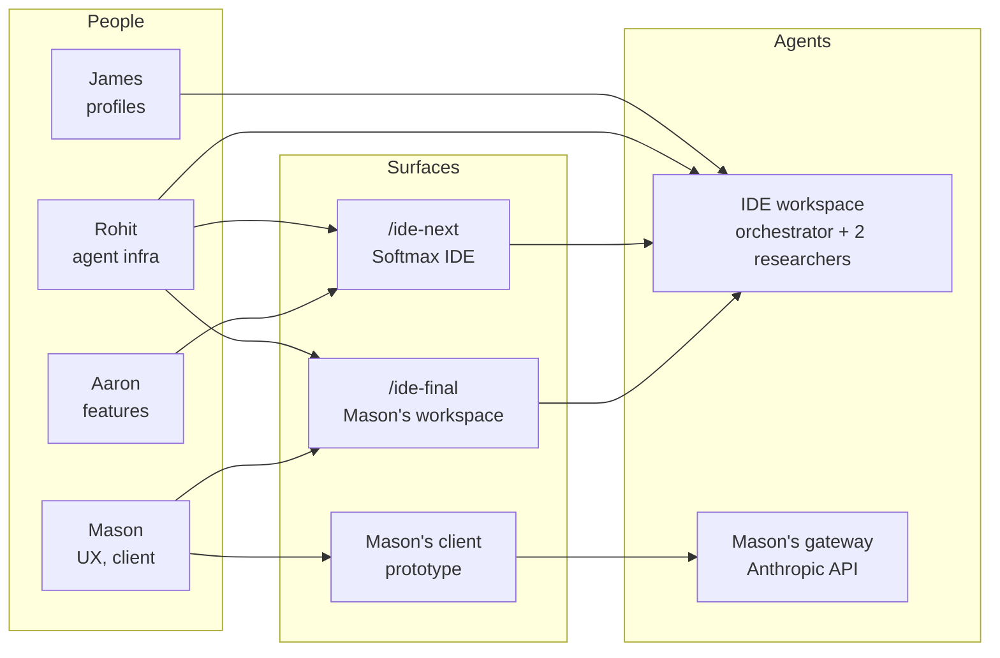
Figure 1 — Who builds which surface, and which agents each surface talks to. Both live surfaces drive the
same hosted workspace; Rohit owns its hosting, James its profiles.

| Surface | URL | Code | Agents | Status |
|---|---|---|---|---|
| Softmax IDE | `softmax.com/ide-next` | `metta/packages/softmax-ide`, built with `NEXT_PUBLIC_IDE_EC2=1`, self-hosted on Kubernetes (EKS) | The user's hosted IDE workspace: orchestrator plus researcher-1 and researcher-2 | Live for any signed-in user; built from `main` automatically |
| `/ide-final` | `softmax.com/ide-final` | Same package, second image (`components/final/`, `lib/ide/`; metta #28522, #28525, #28586) | The same workspace, plus the orchestrator's `ide_workspace` tool at `softmax.com/ide/mcp` (ide-distributions #24) | Live since 10-21; both mounts serve the same revision |
| Mason's client | Local web and Electron app | `masons-ide-explorations` | Mason's TypeScript gateway on the Anthropic Messages API | Prototype; Rohit's draft stack #28801–#28805 ports it |
| Aaron's tabs | (for `/ide-mvp`) | Open metta PR #28101 | Vercel-only goals | Stranded: its target was retired |
| Policy IDE (legacy) | `softmax.com/ide-mvp` | Removed by metta #28583 | — | Returns HTTP 410 since 10-21 |

Out of scope, but sharing infrastructure:
- The **Cogent IDE** (`/ide`) still drives the same IDE workspace and is the only page that shows the
  orchestrator's `ide_say` news (§4.2). Nothing links to it, and no PR removes it.
- **Play** now runs a second, separate workspace on the user's same cogent (metta #28599, #28619), so it
  no longer collides with the IDE.

**The system in one paragraph.** Each signed-in user has one hosted IDE **workspace**: a sandboxed
container on a shared server, started on demand. Inside it, one Hermes process serves several
**profiles**, each a named agent with its own prompt (`SOUL.md`), tools, skills and memory. For the IDE
these are this repo's `orchestrator` (which Rohit's code now calls the "coordinator"), which answers the
user, and two `researcher`s, which work native Hermes Kanban **tasks** in the background. A small
**bridge** process in the same container carries messages between the platform API (Observatory) and the
profiles. The UIs never connect to the container. They read and write records through Observatory, and the
bridge relays them. Appendix A defines these terms.

---

## 2. What users see

- `/ide-next` is chat first. The landing page has a composer and league stats. Sending a message opens
  a two-pane workspace: conversations on the left, tabs on the right (Work board, Research journey,
  Experiments, views).
- `/ide-final` is one GoTA page with an editable layout, a draft card for project notes, and the same chat.
- Mason's full client, with policy workspaces and an agent character, is in flight.

### 2.1 Softmax IDE (`/ide-next`)

- The landing page offers a composer, four starter chips, recent chats, and league performance.
- A chat opens the **request workspace**: the conversation rail on the left, result tabs on the right.

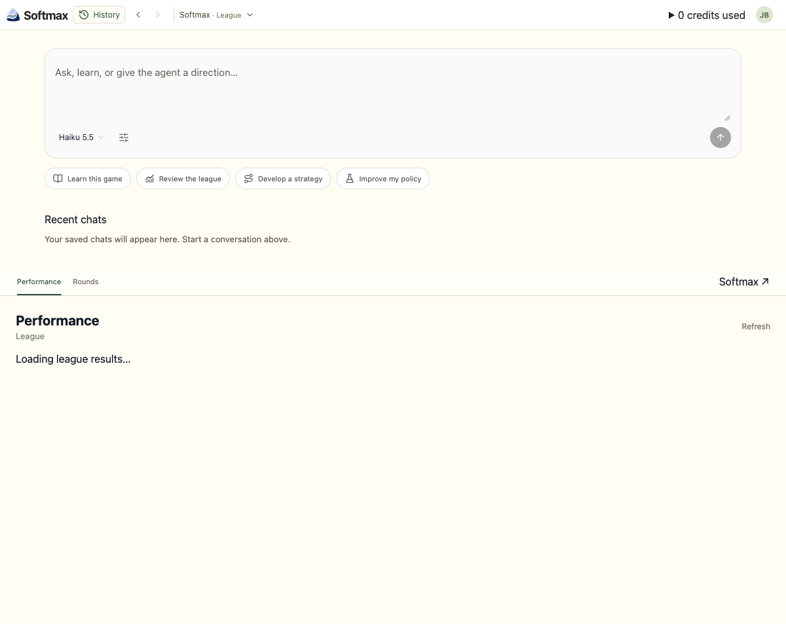

The top bar holds a **History** drawer ("Workspace history — Reopen a previous request in this
league"), Back and Forward, a game and league picker, a daily credit pill, workspace **Pause** and
**Resume** (metta #28471), and the account menu.

The composer ("Ask, learn, or give the agent a direction…") has:
- a model picker, Haiku 5.5 by default. Since metta #28612 (10-21) the hosted path honors it for chat turns
  (`lib/hermes/chat.ts:390-402`); background turns and researchers still use the fleet's model (§5.2);
- **Chat options**: Tool permissions (Ask or Auto, default Auto) and Thinking effort
  (`components/workspace/composer-settings.tsx:24-66`).

Four chips sit below it: *Learn this game*, *Review the league*, *Develop a strategy* and *Improve my
policy*. Each sets a hidden mode (`learn`, `view`, `do` or `research`) that changes the instructions
sent with the message (`components/workspace/workspace-composer.tsx:28-53`; `lib/workspace/composer.ts:12-19`). Below those are "Recent chats" and the league
views, Performance and Rounds, with rank, MMR (matchmaking rating), rounds played and a leaderboard
(`components/league-explorer.tsx:256-419`).

The **request workspace** (`components/workspace/request-workspace.tsx`) has two panes.

The left rail is the conversation:
- a Main chat plus up to 12 child chats that share one canvas (`lib/workspace/request.ts:27`);
- tool-activity rows in the transcript, read from the Hermes session (§3.1);
- task notices, which since 10-22 show the native status directly, for example "Worker finished"
  (`research-task-updates.tsx:5-12`);
- approval cards with Approve and Deny (`hermes-approvals.tsx`);
- an **Agent workflow** panel listing delegated tasks, with Cancel and "Continue this chat when research
  finishes" (`hermes-research.tsx:9-20`, `:139`);
- account research controls: Pause all, Check account status, Resume and Repair.

The right canvas holds tabs:
- **Work board**: Queued, Working, Needs attention and Finished, plus "Chat with researcher"
  (`hermes-work-board.tsx:9-25`). It is the default tab for most chats.
- **Research journey**: findings and checkpoints.
- **Experiments**: appears once a hosted evaluation receipt ("XP", an Experience Request run) arrives.
- **Game guide**, **App** (an agent-edited micro-app), **Replay**, and **Views** the agent creates.

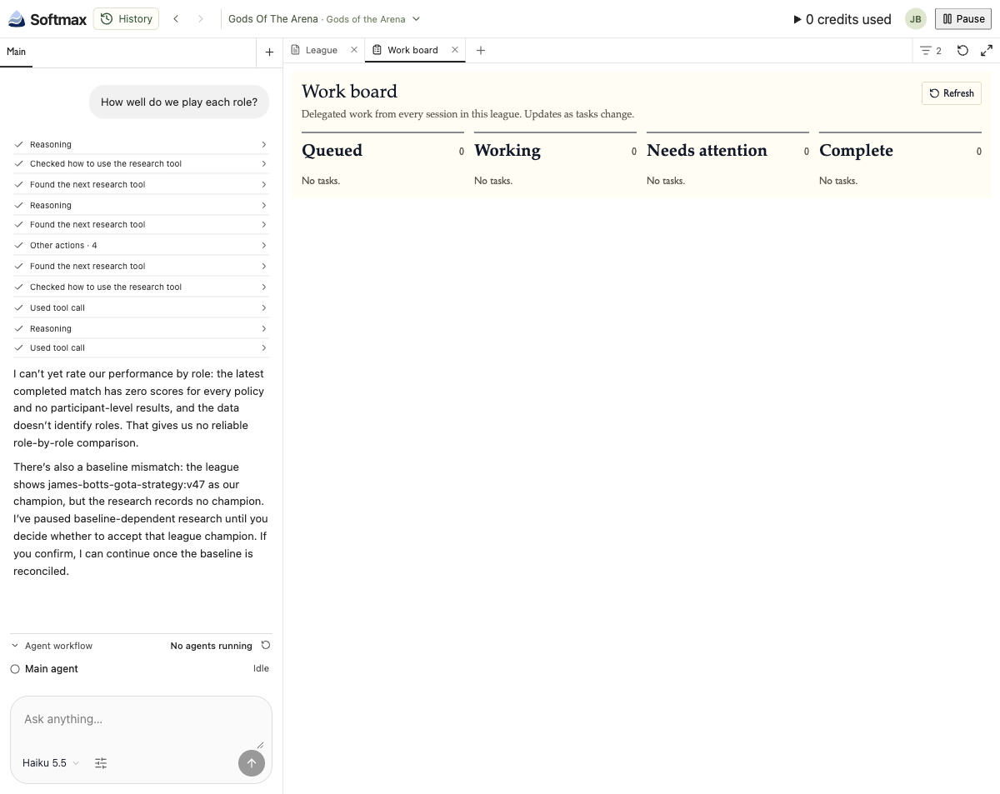

The sketch below is drawn from the code (`request-workspace.tsx:1128-1301`, at `6b5c31b752`) and names every
part, including tabs that Screenshot A2 does not show:

```text
┌─ top bar: History · ◀ ▶ · Game/League ▾ · credits · Pause · account ─────────────────────┐
├─ Conversation rail ─────────────────┬─ Result canvas ──────────────────────────────────────┤
│ [Main] [Chat 2] [+ New conversation] │ [Work board] [Research journey] [Experiments] [+]   │
│                                      │ ┌ Queued ┐ ┌ Working ┐ ┌ Needs attention ┐ ┌Finished┐│
│ you: Improve my policy …             │ │ #3 …   │ │ #4 …    │ │ #2 blocked: …   │ │ #1 …   ││
│ agent: ▸ tool rows · reply · #4 link │ │        │ │ Chat w/ │ │                 │ │        ││
│ ▣ Task updates: #1 Worker finished   │ │        │ │researcher│ │                 │ │        ││
│ ▣ Approve / Deny  container_build    │ └────────┘ └─────────┘ └─────────────────┘ └────────┘│
│ ▣ Agent workflow: Main agent         │                                                      │
│     #4 Researcher · Cancel           │                                                      │
│ [Ask anything…] model ▾ ⚙ Chat options│                                                      │
└──────────────────────────────────────┴──────────────────────────────────────────────────────┘
```

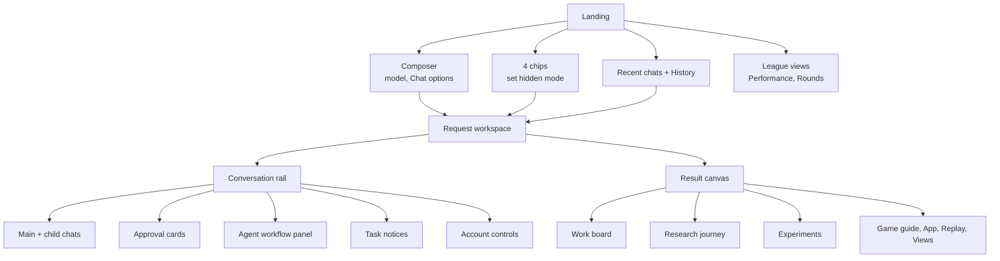
Figure 2 — Anatomy of `/ide-next`. Everything below "Request workspace" appears only after a chat
exists.

### 2.2 `/ide-final`

- One GoTA workspace page with three modes: View, Arrange (drag, resize, remove) and Code (edit the layout as
  JSON).
- A **draft** card holds a title and project notes. The page refreshes it every 10 seconds without
  overwriting unsaved edits (metta #28623).
- It reuses `/ide-next`'s chat component and composer, so every hosted-turn problem in §6 applies to it too.

The page also has the conversations list, Standings, the standard chat composer and workspace Pause and
Resume (`components/final/workspace.tsx`; metta #28649). Only the workspace page is customizable.

Behind it are two documents per owner and league, `layout` and `draft`, each with a revision counter
(`database/migrations/20261021100000_workspace_documents.sql`), and an `ide.operation_receipts` table that
makes agent saves safe to retry. One SDK serves two doors. The browser calls `/api/workspace-sdk` with its
sign-in session (`app/api/workspace-sdk/route.ts:20`). The orchestrator calls `softmax.com/ide/mcp` with its
player credential; the website forwards that path to the IDE's internal `/ide-final/mcp`
(`web/softmax.com/src/proxy.ts:852-863`). Both doors run the same `executeWorkspaceOperation`
(`lib/ide/sdk.ts`). There are eight operations: `components.search`, `components.describe`, `layout.read`,
`layout.validate`, `layout.save`, `draft.read`, `draft.save` and `league.overview` (`lib/ide/schema.ts`).
The league is always GoTA (`lib/ide/schema.ts:51-52`). The owner comes from the credential, never from tool
arguments: the browser keys rows by the sign-in `subjectId`, and the MCP door by `owner_user_id` from
Observatory `/whoami`, cached for 30 seconds (`lib/ide/mcp.ts:154-178`). For one person these are the same
User ID; the PR's system test proved it only with fixture identities.

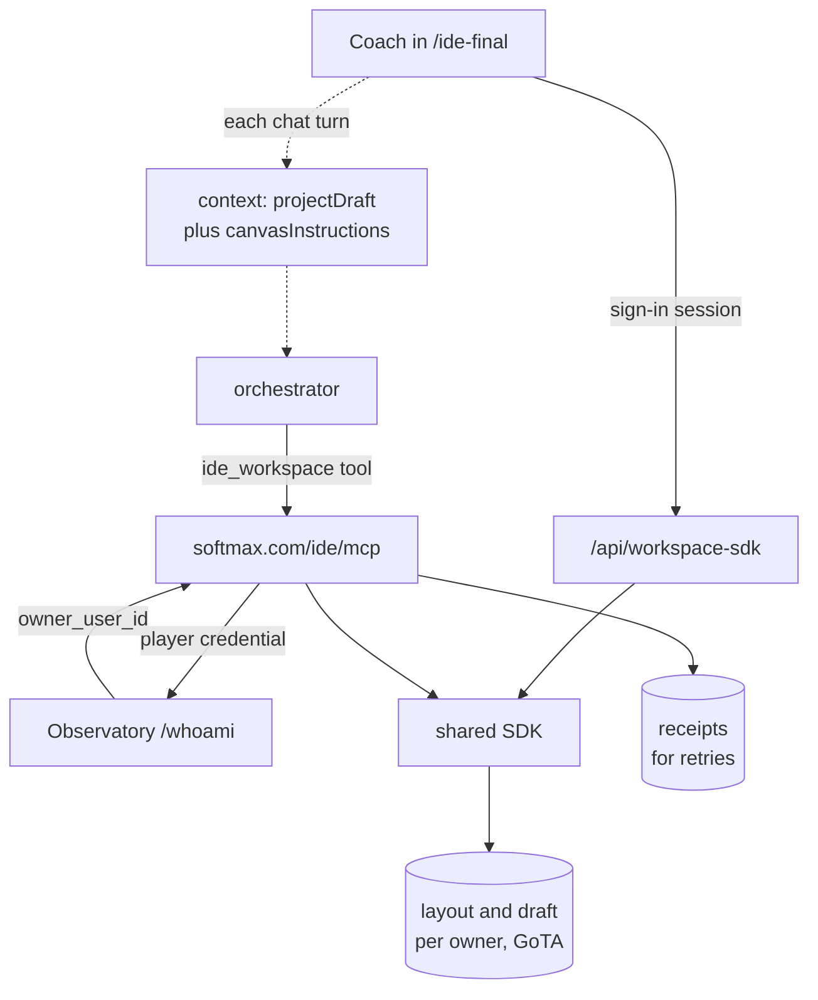
Figure 3 — The two ways into the `/ide-final` workspace. The browser and the orchestrator edit the same two
documents. Each chat turn also sends the draft to the orchestrator, along with `/ide-next`'s old canvas
instructions.

### 2.3 In flight: Mason's application and Aaron's tabs

- Rohit's draft stack #28801–#28805 would mount Mason's whole application at `/ide-final`: his shell,
  policy workspaces, agent views, custom tabs and a hosted Minion Rush tutorial. #28801 adds durable IDE
  source, publication identities, native research context and measured-goal operations.
- Aaron's #28101 brings Mason's Discovery and Goal loop ideas to `/ide-mvp`. That target is gone.

**Mason's client** ("Softmax Client") is a local React app that runs on the web and in Electron.
- **Sidebar**: Dashboard, Players, Policies, Coworlds, Leaderboards, Cogents and Opponents
  (`masons-ide-explorations/apps/web/src/sections.ts:5-13`).
- **Policy workspace tabs**: Info, Code, **Discovery**, **Goal loop**, R/L loop, Leaderboard, Opponents,
  and **Custom**, which the agent builds as sandboxed HTML (`apps/web/src/policies/tabs/index.ts:16-19`).
- **Agent-rebuilt pages**: the agent can rebuild any page as a JSON view of first-party components, and
  the user can rearrange it in Edit mode. This is the part already in `/ide-final`.
- **Character**: the agent floats over the app as a 3D character with a mood it sets itself
  (`set_mood`) and an optional babble voice.
- **Mind panel**: shows the agent's workers as brain cells (`apps/web/src/agent/Workers.tsx:17-21`).
- **Onboarding**: a tutorial with a single-player tower-defence coworld, Minion Rush.

**Aaron's #28101** adds a **Discovery** tab (search saved findings, investigation history, recorded
measurements) and a **Goal loop** tab (objective, verification, constraints and a 1–168 hour duration, with
pause, resume and end). The PR says it is "Inspired by Mason's policy workspace exploration". It targeted
`/ide-mvp` because goals are off on the hosted path (§3.1). It has been open since 10-17 with two unresolved
P1 review findings.

### 2.4 The surfaces side by side

| Capability | `/ide-next` | `/ide-final` | Mason's client |
|---|---|---|---|
| Chat with the agent | Native sessions: a main chat plus up to 12 more | Same chat component | Agent view, mini chats |
| Background work | Work board, Agent workflow panel | Same, through the shared chat | Mind panel, queue |
| Findings | Research journey (empty on hosted) | — | Discovery |
| Goals | Goal strip (off on hosted) | — | Goal loop |
| Approvals | Tool-call cards (no hosted writer) | Same | Ask/approval cards |
| Release | Through agent tools | Through agent tools | Submit draft (always asks) |
| Agent-built UI | App tab, views | Editable layout through `ide_workspace` | Custom tabs, rebuilt pages |
| Project notes | Workspace notes | Draft card, shared with the agent | Notes |

---

## 3. The primitives the UIs assume

- Each surface has its own data model, and the models overlap loosely.
- The words that matter most to the profiles, **goal**, **task**, **experiment**, **draft** and
  **workspace**, mean different things in different places.
- Only three primitives are shared end to end between a UI and the profiles: the chat turn, the native
  Kanban task, and the hosted XP request. `/ide-final` adds a fourth, the layout and draft documents.
- §3.7 turns this into a table of what each primitive asks of the profiles.

### 3.1 `/ide-next`: workspace requests, chat requests, tool calls, goals, tasks

- `/ide-next` keeps its own records in the `ide` schema of the Observatory Postgres database.
- Goals, continuations, the tool-call ledger and the research journey were written by IDE-owned tools,
  served by the IDE's own MCP server. That server (`/hermes/mcp`) was deleted on 10-21 (metta #28583), and
  the hosted workspace was never connected to it. On the hosted path these features can only stay empty.
- Research tasks are native Hermes Kanban tasks, not database rows. They are the one feature here that the
  hosted agent fills.

The records, from the user's screen inward:
- **Workspace request.** Not a request for a container, a goal or a message. It is the saved UI document for
  one `/ide-next` workspace screen, one entry in the History list. It holds the first prompt, the mode,
  the policy, the tabs, notes, app values and saved views, and up to 12 child conversations beside the main one
  (`lib/workspace/request.ts:28-79`). The name comes from its origin: the browser builds it when the user
  submits the home-page composer (`components/workspace/use-workspace-requests.ts:224-268`). It is saved,
  half a second after each change, as the `workspace_request` column of the main conversation's
  `ide.chat_sessions` row (`components/workspace/request-workspace.tsx:186-214`;
  `app/api/chats/route.ts:48-75`). It gets a 12-character short link `/s/<id>`, and Delete archives it.
- **Conversation and chat request.** Each conversation is a row in `ide.hermes_conversations` bound to one
  native Hermes session. A **chat request** is one message, one turn, to run in that session. It is not a
  request to open a chat. Each row holds the user's message and context, the exact `/v1/runs` body sent
  to Hermes, the run ID once Hermes accepts it, and its end state
  (`database/migrations/20261014220000_hermes_chat.sql:10-64`; `lib/hermes/chat.ts:390-401`).
  Admission allows at most one unfinished request per conversation and reserves one daily credit in the
  same transaction. So one workspace request holds several conversations, and each conversation holds many
  chat requests.
- **Tool-call ledger** (`ide.hermes_tool_calls`). Approval states `approval_required → ready → running →
  completed`, or `denied`. Rows came only from IDE-owned tools with effects, admitted through `runHermesTool`
  (`lib/hermes/tools.ts:187-201`; `lib/hermes/calls.ts:28-37`). Nothing in production calls it since
  #28583, so the ledger and the approval cards that read it (`hermes-approvals.tsx`) are empty for the hosted
  agent. The **tool rows** a user does see in the transcript come from somewhere else: the IDE reads the
  Hermes session history through the bridge and pairs each assistant tool call with its output
  (`lib/hermes/chat.ts:477-481`; `components/workspace/use-hermes-chat.ts:574-591`), and labels live activity
  from `tool.started` and `tool.completed` run events (`use-hermes-chat.ts:381-390`). Those include the
  orchestrator's own plugin tools, but only for that conversation's session.
- **Continuations**: waits on hosted operations (XP, builds, submissions) that wake the chat when they
  finish (`20261016010000_hermes_continuations.sql:5-22`). Written only by IDE tools.
- **Goals**: at most one per conversation, with an objective, verification and deadline; most conversations
  have none (`database/migrations/20261016040000_hermes_goals.sql:3-4`). In the retired Vercel-hosted IDE,
  upstream Hermes's `GoalManager` ran them. It calls itself "the Ralph loop for Hermes": after each turn a
  separate judge model decides `done`, `continue`, `wait` or `blocked`, and on `continue` the next prompt is
  sent as a new user turn. The IDE ran it from a Python script inside the Vercel sandbox
  (`workers/hermes/goals.py`; `lib/hermes/goal-runner.ts:113`). Goals are **off on `/ide-next`** by design:
  Aaron's metta #27949 (10-16) says "Persistent goals target retained IDE Hermes; EC2 keeps its existing tools
  and scheduler" (`lib/hermes/goals.ts:3-4`). The hosted worker has no goal or judge configuration.
- **Research journey checkpoints**: a findings log with hypothesis, finding, next step and evidence, saved by
  the `research_journey` IDE tool into `ide.research_checkpoints` (`lib/research/journal.ts:24-42`). The tab
  does not read that table. It rebuilds entries from the transcript, from `research_journey` calls or a fixed
  list of IDE operation tools such as `hosted_xp_wait` (`lib/workspace/research-journey.ts:63-150`). The hosted
  orchestrator has neither, so the tab stays at "Waiting for the first research checkpoint" (§7).
- **Research tasks**: the same native Kanban tasks on board `autoresearch` that the orchestrator creates and
  the researchers work. The browser asks the bridge's `/softmax/research` control for them, sent as a request
  record, and the bridge reads the board's database directly (`lib/hermes/research.ts:31-49`;
  `observatory_hosted_worker/bridge.py:2177-2262`). The Work board asks for scope `league`, so the bridge
  returns tasks the orchestrator created from any of the user's `/ide-next` or `/ide-final` conversations in
  the selected league (`bridge.py:1121-1133`). Tasks created in an `/ide` chat, or during a cron wake whose
  stored session is an `/ide` chat, do not appear, and neither do tasks from other leagues. Since 10-22 the board shows native
  status directly: there is no `outcome` field, no "unverified" state, and `done` reads "Worker finished"
  (`lib/hermes/research-schema.ts:3-15`).

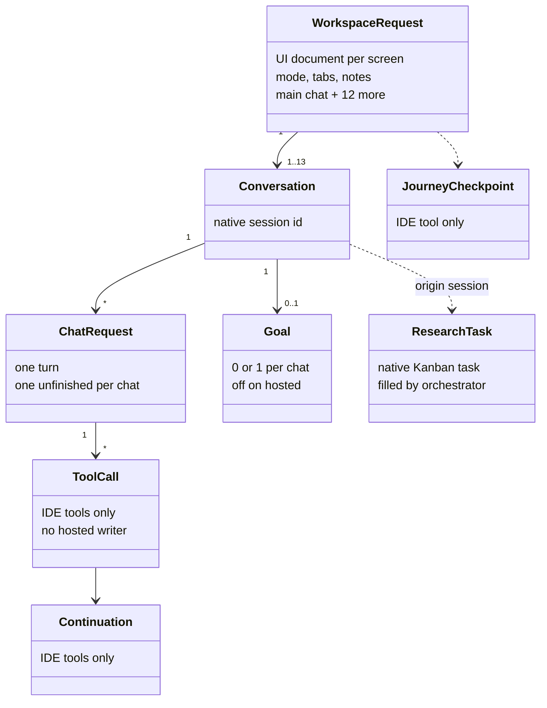
Figure 4 — The `/ide-next` data model. Only the workspace request, conversations, chat requests and research
tasks get data from the hosted agent. The rest needed IDE tools whose server no longer exists.

### 3.2 `/ide-final`: layout, draft, receipts

- Two owner-scoped documents per league, `layout` and `draft`, each with a revision counter (§2.2).
- `ide.operation_receipts` records each agent save, so the same `request_id` with the same arguments returns
  the first result, and with different arguments returns `request_conflict`.
- The draft is a title and notes today. Rohit's plan has it "identify and edit real source" in Phase 1 (§8).

§2.2 describes both doors. These are the only IDE records the hosted orchestrator can write, through
`ide_workspace`.

### 3.3 The profiles: records, tasks, the coordinator, news

- The orchestrator and researcher profiles share one vocabulary, `ontology/ONTOLOGY.md`.
- Their research state lives in a git repository inside the workspace, which no UI reads.
- Their user-facing outputs are the orchestrator's chat reply, the tasks on the Work board, and
  `ide_workspace` edits. `ide_say` news reaches only `/ide` (§4.2).

The vocabulary:
- **Records**: Topic (`T-`, "A research goal"), Hypothesis, Experiment, Result, Version, Claim, Hub,
  Evidence, Journal and Lesson.
- **Decisions**: an experiment's decision is promote, hold, refute or invalid.
- **League terms**: Champion, Candidate, Promotion (kinds `experiment`, `requested`, `bootstrap` and
  `accepted`), XP request, credits and permit asks.
- **Tasks**: "a bounded native Hermes assignment to one researcher". Since 10-22 there are no card kinds,
  entity keys or attempt counters: "Task meaning is its objective and instructions, not a
  kind/entity/attempt key" (`ontology/ONTOLOGY.md:69-89`). The orchestrator's tools still say `card_*`.

How the orchestrator works since 10-22 (ide-distributions #30, metta #28679):
- **One input stream.** "All user input, worker notifications and periodic wakes belong to one decision
  stream" (`orchestrator/SOUL.md:3-4`). §4.4 shows the queue.
- **The coordinator owns publication.** Researchers stage builds in their task branch and finish. The
  orchestrator uploads (`upload_build`), integrates (`workspace_integrate`) and submits
  (`orchestrator/SOUL.md:48-56`). Researchers are denied `workspace integrate`, `workspace publish` and
  `softmax upload`.
- **Conversation-led subject** (#25). "The coach's latest instructions choose the game, Coworld, league and
  player. UI selections, owned-player summaries and workspace defaults are adjustable hints"
  (`orchestrator/SOUL.md:8-11`). It resolves them with `discover_leagues` and `league_players`, and loads
  each game's guide with `game_support`. Since metta #28573 every IDE turn sends the user's owned players
  and the selected league as hints (`lib/hermes/chat.ts:347-357`).
- **Explicit requests are first-class.** "For build, smoke, upload or explicit submission requests, perform
  exactly the requested flow", with `submit_requested_version` and no experiment (`orchestrator/SOUL.md:65-69`).
  Statistical research is optional work with its own budget.
- **Episode budget.** A shared ceiling on hosted episodes per workspace, default 200 from metta, which the
  orchestrator can only lower (`budget_limit`) and reads through `status` (`shared/ide_research_core/budget.py`).

Before 10-22 the SOUL also defined five **coach chat commands**: `task:`, `cancel:`, `pause research`,
`resume research` and `promote now`. They were plain-text prefixes that a coach was meant to type into
chat; the model read them as instructions to create a task, archive tasks, pause or resume research, or
submit a promotion. No UI ever sent them, and #30 deleted them. Pausing research is now just the
`control_write` tool, used when the model decides to.

**`ide_say`** posts up to 20,000 characters of "background news" to the cogent's chat log, with no session
(`orchestrator/src/orchestrator/ide.py:36-50`). The SOUL still says to use it: "Use the bridge's final reply
for user turns; `ide_say` for background news with a stable event key" (`orchestrator/SOUL.md:82-83`). Neither
IDE surface reads that log, so today the tool spends turns writing text that only the unlinked `/ide` page
shows (§4.2, §6.2).

The ontology never defines goal, news, priority, practice, release, draft or workspace.

### 3.4 Mason's client: neurons, findings, goals, drafts, one mind

- Mason makes measurement the centre of the UI. **Neurons** are measured policy building blocks.
  **Goals** are numeric targets on one neuron.
- Findings, neurons, links, goals and notes are durable backend resources, all marked "provisional".
- The chat and the workers are framed as one mind, and the prompt forbids describing them as a team.
- None of this is in `/ide-final` yet; #28801 adds "measured-goal operations" (§2.3).

From his gateway schema (`masons-ide-explorations/packages/agent-protocol/src/generated/schema.ts`), except
Draft, which the app derives from league submissions (`apps/web/src/policies/draft.ts`):
- **Neuron**: "A building block of a policy: something it does or something that decides its games,
  measurable (in Pudge Wars: hooks landed, win rate…)". It holds per-version readings with sample size and
  spread.
- **NeuronLink**: one neuron raises or lowers another, with a confidence level.
- **Finding**: something learned about the game, coworld, field or policy, with evidence. Findings marked
  `edge` sort first.
- **Researcher**: a sticky worker thread per policy that keeps its own history.
- **Goal**: a numeric target on one neuron. After each round, the gateway (not the model) checks the
  latest measurement. It starts another round until the goal is met, judged impossible, or stalled.
- **Representation**: a chart of what lies behind a neuron's number.
- **Note**: direction from the user or the agent, with no evidence needed.
- **Draft**: the policy is what was submitted to a league. Everything uploaded since is a "test build".

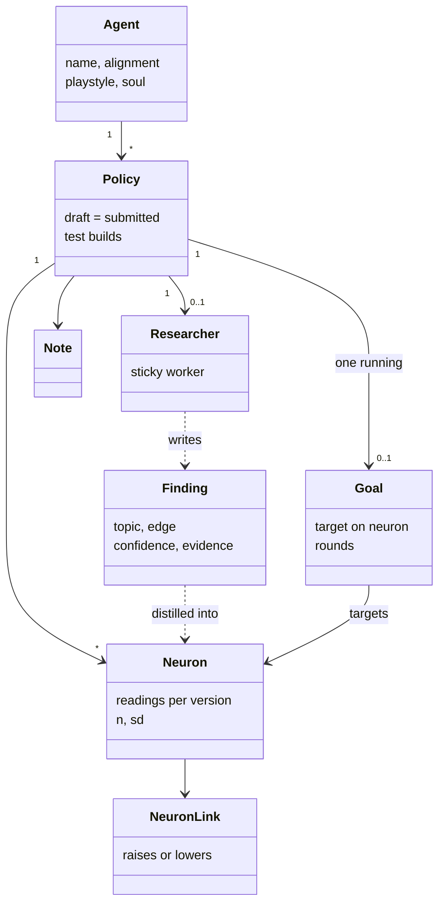
Figure 5 — Mason's data model. Everything except the policy's draft reading lives in his gateway, keyed by
agent and policy.

"Chat" means three things in his repo: the agent's rule-based remark bubble, which is the design doc's own
definition (`docs/design/ui-principles.md:474-477`); a `chat` thread, as opposed to a `worker` thread; and
small inline chats on pages. The workers are "more of your own mind", never "assistants, helpers, or a team"
(`packages/agent-gateway/src/runtime/prompts.ts:49-51`).

### 3.5 Coach rules and permits

- A **permit** is the platform's request for the user's approval before certain acts, such as a league
  submission or a large spend. It is the only coach-side control that reaches the profiles.
- The coach's standing rules (cadence, reasoning, daily credits) live in a record the profiles never read.
- Aaron's replay **coaching** is a separate product; no profile uses it.

**Where these live.** `profile/coach`, `profile/soul` and the `asks` inbox are cogent records in the
Observatory platform's Postgres database, not in the IDE's `ide` schema. `cogent_records` keeps every
revision, keyed by player, collection, key and revision, and `cogent_record_heads` points at the latest
(`metta/workspaces/observatory/platform/packages/core/src/observatory_core/models/cogents.py:133-192`). Clients
read and write them through `/v2/cogents/{player}/c/{collection}/{key}`. Only the coach may write
`profile/coach`. `profile/coach` holds cadence, reasoning, `dailyCredits` and `askBefore`.

**What a permit is.** A permit is a record of kind `permit` in the cogent's `asks` collection. Its body
names the `action` (`submit`, `spend`, `join-team`, `public-post` or `share`), the exact act (`ref`), an
optional credit `amount`, a reason, and later an `answer` and a `used` time. The server creates it inside
the request that attempts a governed act, and refuses that request with 403 `permit_required`. The coach
answers by setting `answer`; only the server sets `used`. A "yes" covers exactly one act and is used up by
it; nothing expires on a timer
(`metta/workspaces/observatory/platform/packages/core/src/observatory_core/cogents/permits.py:182-401`). The
governed acts are league submissions, XP requests, and public record writes. Whether an act needs a permit
depends on `askBefore` and on what is left of today's `dailyCredits`; with no `profile/coach` at all,
everything asks.

**How the profiles meet it.** Only as a refusal followed by a later answer. A researcher blocked on a permit
records the ask in `metadata.awaiting.permit`; the orchestrator's cron gate polls it and queues a wake when
it is answered (`orchestrator/src/orchestrator/gate.py:16-57`). Promotions read the answer through the
shared client, whose path is wrong in production (§6.4). Neither profile reads `profile/coach` itself, so
cadence and reasoning preferences have no effect on the hosted agent. `/ide-next` and `/ide-final` do not
show asks at all, so their users cannot answer one (§6.2).

**Coaching.** Aaron's replay coaching (screen and voice notes over a replay, turned into structured feedback
for the research loop; meeting notes, 9-25) lived in the Observatory UI, which moved behind the staff-only
`/admin` flag on 10-21. His draft metta #28151 adds a coaching SDK and a skill `cw.coaching`, but it does not
touch the IDE package. No profile consumes coaching output today.

### 3.6 One word, many meanings

- "Goal", "task", "experiment", "draft" and "workspace" each mean several things across the surfaces.
- A profile change that serves one meaning does not serve the others.

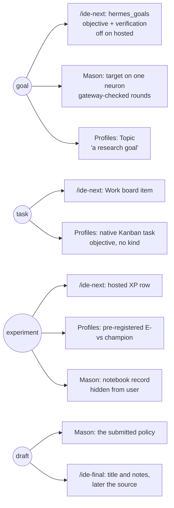
Figure 6 — Four central words and what each surface means by them. The profiles have no "draft"; they use
version records and the champion.

"Workspace" has five meanings:
1. The hosted container (the "workspace" of Pause and Resume).
2. The `/ide-next` request workspace: tabs, canvas and research journey (§3.1).
3. The `/ide-final` owner-scoped layout document (§3.2).
4. The researcher's canonical-Git work area (`shared/ide_research_core/workspace.py`; Rohit's plan links its
   generated orchestrator copy as the "research repository implementation").
5. The `gameWorkspace` context field.

In this report, "workspace" alone means the hosted container.

### 3.7 What each primitive asks of the profiles

- This is the bridge from the UIs to the profiles. Each row is a requirement some UI places on the
  hosted agent.
- "Match" means the profiles meet it today, end to end.

| Primitive | Requirement on the agent | Who must meet it | Today's mechanism | Match | §6 item |
|---|---|---|---|---|---|
| Chat turn | Answer in the native session; understand the four chip modes | orchestrator | Bridge run; mode arrives only as hint text, beside stale tool instructions | Partial | M1–M3 |
| Subject selection | Work on the game, league and player the user means | orchestrator | Owned-player and league hints each turn; discovery tools | Yes | — |
| Background task | Visible task with status; "Chat with researcher" | orchestrator, researcher | Native tasks read live by the bridge | Partial: only tasks from IDE chats in the selected league | M4, M15, M21 |
| Finding | Write findings with evidence somewhere a UI reads | researcher | Claims and journals in canonical git; nothing exported | No | M5, M6 |
| Goal | Accept a goal, check it, report progress | orchestrator | None; goals are off on hosted | No | M5, M13 |
| Experiment | Show hosted runs and decisions | researcher | XP via the research CLI; decisions in git | Partial (XP only) | M6, M13 |
| Approval | Stop for the owner's yes on risky acts | both | Platform permits; deny lists; no permit view in the IDE | Partial | M10, M16 |
| Release / promotion | Submit only with consent; show the champion | orchestrator | `promotion_submit`, `submit_requested_version`; no UI control | Partial | M7 |
| News | Report background results where the user looks | orchestrator | `ide_say` to the chat log, which no IDE surface reads | No | M9 |
| Pause research | Stop new work on the owner's request | orchestrator | `control_write` tool; no UI button | Partial | M8 |
| Budget | Respect the owner's spending limits | both | Episode budget (default 200) and coach credits; no UI for the episode budget | Partial | M11, M12 |
| Layout and draft | Read and edit the shared page and notes | orchestrator | `ide_workspace` | Yes, untested live | M20 |
| Neuron (Mason) | Per-version measured metrics with sample size and spread | researcher | Result metrics with confidence intervals in git | Partial | §8.2 |

### 3.8 Primitives that are easy to miss

- An independent Codex review read the code without seeing this report or James's starting list. It
  found about 150 primitives in 11 themes. The full table, with citations at metta `2a69374811`, ships as
  a companion file: `docs/reports/ide-ux-system-map-2026-10-21-primitive-inventory.md`. Most of its rows
  belong to `/ide` and are now out of scope.
- The table below keeps the ones that matter for `/ide-next`, `/ide-final` and the profiles.

| Primitive | Where | What it asks of the agent | Profiles today |
|---|---|---|---|
| Single-use permit | Platform permits (§3.5) | A yes covers one exact act and amount, then is used up | Promotion reads the answer through the broken path (M16) |
| Budget clocks | Coach credits use UTC days (`metta/workspaces/observatory/platform/api/src/observatory_api/routes/app/v2/cogents/permits/schemas.py:15`); the IDE allowance resets at Pacific midnight (`lib/credits.ts:6`); the episode budget never resets | Carry each budget's type, scope and reset clock | `credits` reads one balance; `budget_limit` lowers the episode ceiling |
| Outcome-unknown recovery | Bridge recovery states (`metta/workspaces/observatory/platform/packages/core/src/observatory_core/cogents/bodies.py:591`) | A lost observation is not a failure; don't repeat a build, upload or submission | The coordinator replays with stable `command_id`s; promotions use shared receipts |
| Original-session lineage | Delegated work returns to its chat (`metta/packages/softmax-ide/docs/system-overview.md:24`) | Deliver completion to the chat that asked | Task results return to the creating session; cron wakes go to the last session that called a tool, and `ide_say` drops the session (M9) |
| Structured user question | `/ide-next` question card (`lib/hermes/input-schema.ts:3`) | Ask through the question channel and wait for the answer | Not available on hosted (an IDE tool) |
| Retained tool output | `read_tool_output` (`lib/tools/read_tool_output.ts:6`) | Page a large stored result instead of rerunning the action | IDE tool; not given to hosted profiles |
| Pinned presentation | `/ide-next` canvas (`lib/workspace/presentation.ts:40`, `:52`) | Don't replace a view the user pinned | Hosted profiles don't drive the `/ide-next` canvas |

Codex also listed name collisions worth adding to Figure 6:
- "run" means an inference run, an evaluation record, or a compute job;
- "skill" means agent instructions in Mason's client and a research procedure in `/ide-next`;
- "checkpoint" means a journey update, a research observation, a restorable compute artifact, or now an
  integrated commit in a task branch;
- "publish" means a public record, a custom tab, or the last stage of a promotion.

---

## 4. System map: how the UI reaches the agents

- Every user gets one hosted IDE **workspace**: a container sandboxed with gVisor (a kernel that isolates
  the container from the host), on a shared EC2 server. One Hermes **gateway** process in it serves
  several profiles, and a **bridge** connects out to the API.
- `/ide-next` and `/ide-final` reach the agent by writing request records (`c/hermes_requests`) and reading
  response records (`c/hermes_responses`). Live output streams back through Redis and the bridge's open
  connection.
- The bridge sends every plain chat request to the **orchestrator**; nothing in the UI picks a profile.
- Since 10-22 every orchestrator input waits in one first-in, first-out queue (§4.4).
- The bridge is metta code (`packages/observatory-hosted-worker/src/observatory_hosted_worker/bridge.py`,
  about 2,600 lines). Rohit wrote 21 of its 28 commits; Maxwell 4, James 2, Aaron 1. A change to how chat,
  news or tasks travel is a metta change; the profiles control only what they send into it.

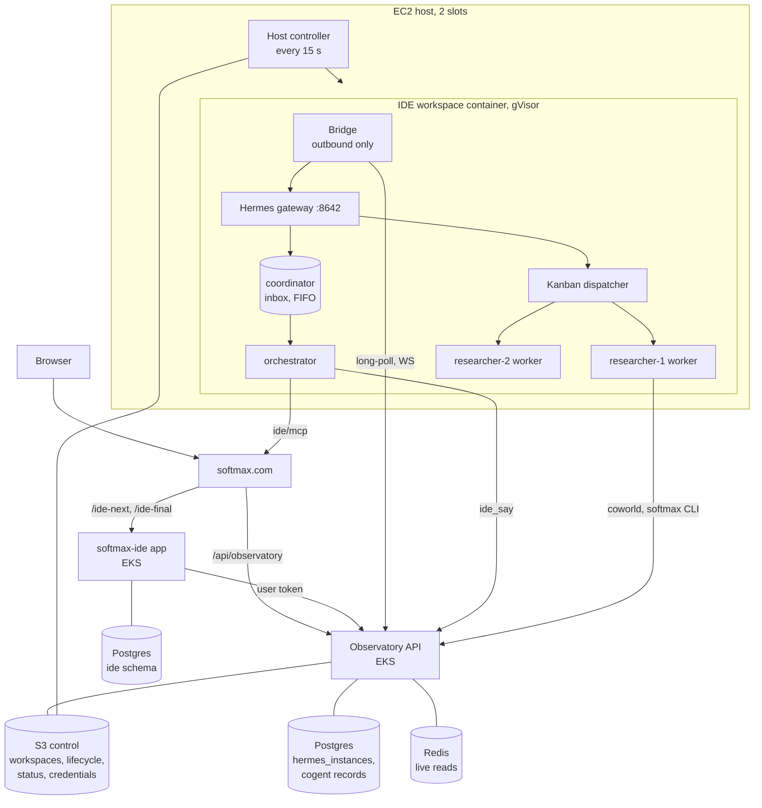
Figure 7 — The whole system. The IDE never connects to a container. Everything crosses the Observatory
API, either as records or through the bridge's outbound connection.

### 4.1 One `/ide-next` chat turn

- The IDE saves each message twice: first in its own ledger, then as an Observatory request record.
- The bridge forwards it to `/p/orchestrator/v1/runs`. Which profile answers is fixed by the runtime
  definition, not chosen per message.
- The run's events stream back live; the transcript is reread from the Hermes session.

The steps:
1. The browser posts to `/api/hermes/chat`. The IDE saves a chat request in `ide.hermes_chat_requests` and
   returns.
2. The IDE builds the run body (`lib/hermes/chat.ts:346-402`): the conversation's `session_id`, the user's
   message as `input`, the selected model and reasoning effort, and an `instructions` string written per
   turn. That string opens with "You are the user's Softmax IDE research agent", tells the agent to infer the
   game, league and player from the conversation, and then adds a JSON block with the conversation ID, the
   league, the user's owned players, and the whole client workspace context: chip mode, `canvasInstructions`,
   the presentation token and the saved tabs. On the hosted path it also adds "Use the installed coach
   tools…" (`chat.ts:363-364`), followed by "Use the installed profile distribution to delegate independent
   research on this VM… Only submit a policy to a league when the human explicitly requests submission"
   (`chat.ts:366-368`), the one hosted line that does match the profiles. These instructions sit on top of
   the orchestrator's own SOUL, and the profiles have no control over them.
3. The IDE's dispatcher (every 3 s, up to 4 per query, backing off to 60 s after errors;
   `lib/hermes/dispatch.ts:14-60`) writes the request as `c/hermes_requests/<uuid>` with path `/v1/runs`
   (`lib/hermes/ec2.ts:93`).
4. The IDE workspace's bridge sees the record on the cogent's change feed. Its Hermes client is rooted at
   `http://127.0.0.1:8642/p/orchestrator/`, because the IDE runtime sets `bridge_profile=orchestrator`
   (`metta/devops/hermes-fleet/applications/autoresearch/runtime_definition.py:29`;
   `observatory_hosted_worker/fleet.py:332`). Since metta #28610 only a bridge whose application is `ide`
   runs these records (`bridge.py:2524-2531`).
5. Hermes accepts the run, and the bridge writes the receipt with the run ID as `c/hermes_responses/<uuid>`
   (`bridge.py:2418-2493`). The IDE waits for it on the change feed (`ec2.ts:110`).
6. The browser streams the run's events through `GET /v2/cogents/{player}/hermes/reads`, which the API relays
   over Redis to a WebSocket the bridge keeps open
   (`metta/workspaces/observatory/platform/api/src/observatory_api/routes/app/v2/cogents/hermes/reads/service.py:42-104`).
   That is how the reply text and tool rows appear live.
7. On reload, the IDE reads the transcript from `/api/sessions/<id>/messages`, 50 messages per page
   (`chat.ts:477-481`). The orchestrator's answer is simply the last assistant message in its session.

The Work board and "Chat with researcher" use the same request records, through the bridge's
`/softmax/research` control (list, cancel, wait, unwait, chat), which works directly against board
`autoresearch` (`bridge.py:2177-2262`). "Chat with researcher" opens a separate discussion session on the
task's assignee profile, the one place where a researcher talks to the user.

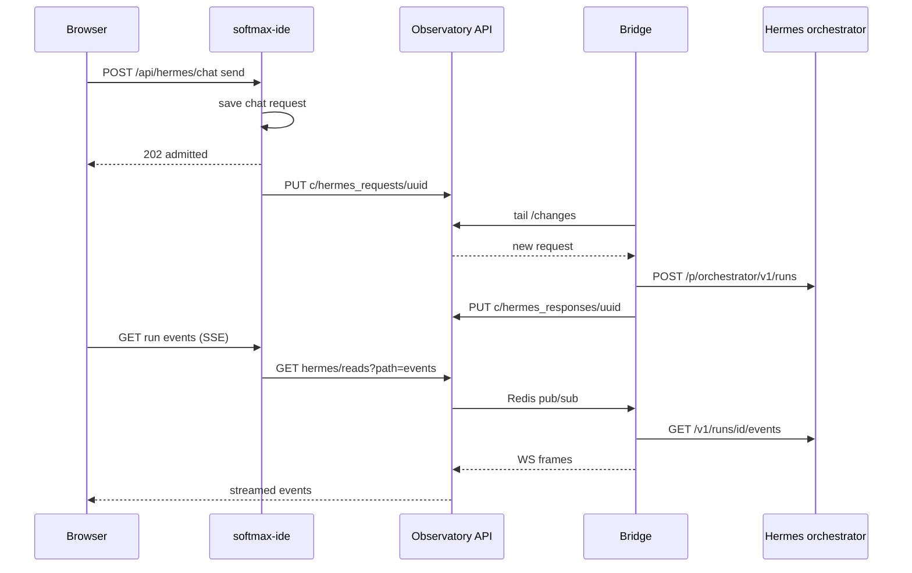
Figure 8 — One `/ide-next` chat turn. Writes travel as records. Reads stream through the bridge's live
connection. `/ide-final` uses the same path.

### 4.2 Where background news goes

- The answer to a chat turn is that turn's final reply, in the conversation's own session.
- Work that finishes later reaches the user in two other ways, and neither is reliable on `/ide-next`.
- `ide_say` posts to the cogent's `chat` log, which only `/ide` reads.
- A finished task reports back in the session that created it. A cron wake (XP results, credits, permits)
  runs in the session the orchestrator stored last, which may not be the chat that asked.

`ide_say` posts to `/v2/cogents/{player}/say` without a `session_id`, which the API reads as "the original
chat" (`orchestrator/src/orchestrator/ide.py:36-50`;
`metta/workspaces/observatory/platform/api/src/observatory_api/routes/app/v2/cogents/loop/schemas.py:30-34`). A
search of `metta/packages/softmax-ide` for `logs/chat`, `say` and `wait` finds no reader. Its only change-feed
reader watches `native_research`, and only to know when to refetch the task list
(`app/api/hermes/research/updates/route.ts:57-63`). So on `/ide-next` and `/ide-final` the news is never shown.

The wake reply is what the user does see. `card_create` subscribes the session that created the task
(`orchestrator/src/orchestrator/board.py:28-37`, `:222`), and the coordinator patch queues each task event for
that session. So when a task finishes, the coordinator's turn runs in the chat that created it, and its final
reply appears in that transcript. Cron wakes are different: they run in the origin session the orchestrator
stored last, the session of the last tool call that carried one
(`orchestrator/src/orchestrator/plugin.py:263-273`; `gate.py:95-108`). So an XP result, returned credits or
an answered permit can surface in a different chat from the one that asked. On 10-21, before the redesign, live testing saw
exactly this: the raw wake text and "Event reported and acknowledged." (§7, Figure 18).

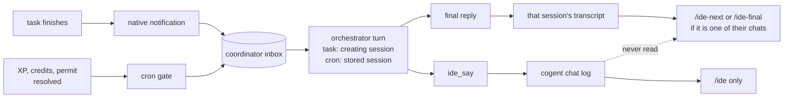
Figure 9 — Where background news goes. A task's result reaches the chat that created the task, a cron wake's
result reaches the stored session, and `ide_say` reaches only the unlinked `/ide` page.

### 4.3 Long-running and short-lived agents

- The gateway, the bridge and the orchestrator live as long as the container.
- Researcher work is short-lived: one worker process per task, at most one per researcher.
- A task's defaults come from `card_create`: 7,200 s runtime and a failure limit of 2, which allows one retry
  (`orchestrator/src/orchestrator/board.py:90-91`, `:187`).

| Agent | Lifetime | What starts it |
|---|---|---|
| Hermes gateway (one per workspace) | Container lifetime | Supervisor runs `hermes -p default gateway run` (`observatory_hosted_worker/runtime.py:299`) |
| Bridge | Container lifetime | Supervisor (`runtime.py:342`) |
| Orchestrator | Resident. One turn per inbox input: a chat line, a task notification or a cron wake | The coordinator inbox (§4.4) |
| Researcher worker | One process per task; at most 1 per researcher, 2 in total | Gateway Kanban dispatcher (`metta/devops/hermes-fleet/applications/autoresearch/prepare.py:160-179`) |
| "Chat with researcher" | A discussion session on the assignee profile | Work board button |

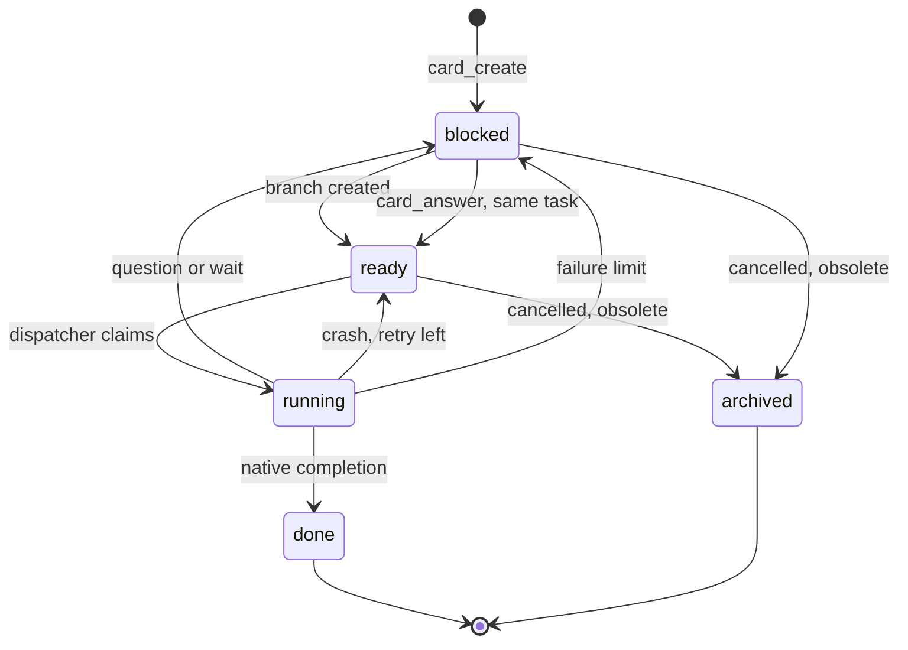
Figure 10 — A research task's life since 10-22. A task starts blocked until its branch exists
(`board.py:194`, `:218-219`). A blocked task resumes as the same task; there are no replacement tasks or
attempt counters (`orchestrator/SOUL.md:35-46`).

### 4.4 The coordinator inbox

- Since 10-22 every orchestrator input goes through one durable first-in, first-out queue, the
  **coordinator inbox**, added to Hermes by a metta patch. Only the oldest unfinished input runs.
- Task events arrive as native notifications. The cron job no longer runs a model; it only polls external
  waits and queues a wake.
- Finishing a turn consumes its input, so there is no acknowledgement tool.

The pieces:
- **The queue.** When a profile ships `coordinator.json` (the orchestrator does: `{"scope": "research"}`),
  every turn goes through a SQLite `coordinator_inbox`. A crash leaves the input pending for recovery
  (`metta/packages/observatory-hosted-worker/patches/hermes-workspace-coordinator.patch`; metta #28679).
- **Task events.** Kanban notifications are queued once, as `kanban:<board>:<task>:<event>` inputs.
- **The cron gate.** The `supervisor` job runs every minute with `no_agent: true`
  (`orchestrator/cron/jobs.json`). Its script checks only external waits: XP results, returned credits and
  answered permits, plus a promotion poll every 10 minutes while one is in flight
  (`orchestrator/src/orchestrator/gate.py:16-74`). If something resolved, it queues a wake input for the
  stored origin session ("Background coordinator wake. Read current status before acting…"). Every tick it
  also launches the oldest abandoned input (`gate.py:81-128`).
- **The turn.** The orchestrator starts with `status`, acts, and may send `ide_say`.

Two consequences follow by inference; neither has been tested live:
- A user's chat line waits behind any running wake or notification turn, and two open chats no longer run
  in parallel.
- A cron wake runs in the last session that called a tool, so an XP, credit or permit result can land in a
  different chat from the one that asked. Task results go to the chat that created the task.

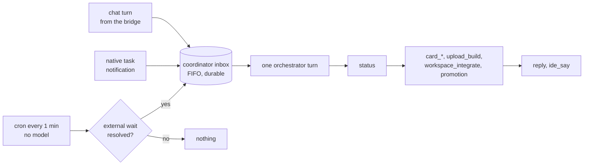
Figure 11 — The coordinator inbox. Chat, task events and cron wakes share one queue, and one turn runs at a
time.

### 4.5 Research to champion, end to end

- One improvement crosses both profiles, the platform and several tasks.
- The permit step is where the production bug in §6.4 stalls the loop.

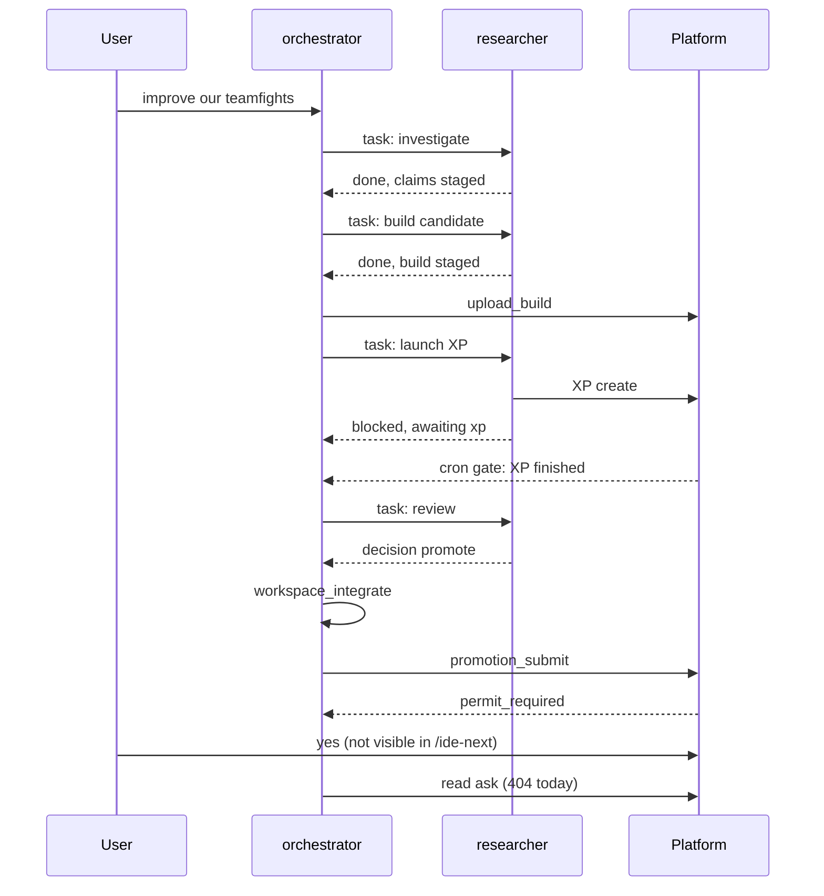
Figure 12 — The full research loop since 10-22. The coordinator uploads and integrates; researchers build,
launch XP and review. The final "read ask" step fails (M16), so a promotion that needs a permit stays at
`intent`. On a champion conflict the orchestrator pauses research and calls `accept_champion` only after the
user chooses (`orchestrator/SOUL.md:75-76`).

---

## 5. How the Hermes profiles are installed and live

- Production installs the profiles from **ide-distributions `main` HEAD**, checked every 5 minutes. The
  committed lock in metta does not gate it.
- A workspace picks up a new image only when its owner pauses and resumes it. Since 10-22 that resume can
  be refused, leaving the workspace stopped until an operator acts.
- Metta still patches the profiles at start time in one way this repo could ship itself.
- IDE workspaces never go to sleep, because the orchestrator ships a cron job. Open metta #28685 would
  change that.

### 5.1 What is in each profile

- The orchestrator is a coordinator with tools and no hands: 29 plugin tools, a cron gate, no terminal and
  no skills.
- The researcher is a worker with hands: a terminal, a 22-skill library, the research command-line tool,
  doctrine, and a guard plugin. It stages work; it cannot upload, integrate or publish.
- Both share the ontology and the GotA game contract, `GAME.md`.

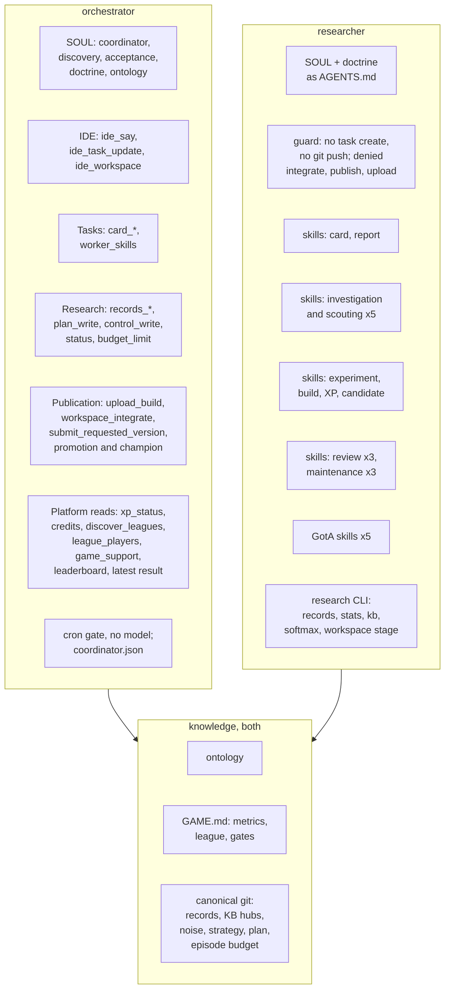
Figure 13 — Inside the two research profiles (`orchestrator/plugins/orchestrator/plugin.yaml:6-34`;
`orchestrator/src/orchestrator/plugin.py:21-254`; `researcher/skills/`; `researcher/plugins/researcher_guard/`).

Which UI primitives each part serves:

| Profile part | Serves | Unused by any IDE surface |
|---|---|---|
| Chat reply | `/ide-next` and `/ide-final` transcripts | — |
| `ide_say` | News on `/ide` only | Yes |
| `ide_task_update` | IDE tasks (`c/tasks`) | Yes; no IDE surface creates tasks for the orchestrator |
| `ide_workspace` | `/ide-final` layout and draft | — |
| Task tools + researcher `card` skill | Work board | — |
| Records, plan, control, KB, stats, budget | — | All of them; nothing outside the container reads canonical git |
| Publication and promotion tools | — | No champion or release view anywhere |
| Platform reads and discovery | Chat answers about leagues, players and games | — |
| Experiment, review and maintenance skills | Tasks commissioned in chat | No experiment or decision view |

### 5.2 From a merge to a running profile

- The release workflow polls ide-distributions `main` every 5 minutes and builds an image when the
  profile trees change.
- New workspaces get it right away. Existing ones get it on their next Pause and Resume.
- Production overrides the profiles' model, but since 10-21 an IDE chat turn uses the model the user picked.

The `deploy-hermes-agent` workflow resolves `repos/Metta-AI/ide-distributions/commits/main` and builds
with `--update-lock` (`metta/.github/workflows/deploy-hermes-agent.yml:71`, `:128`). It runs only while
the repo variable `HERMES_WORKSPACE_UPDATE_POLICY` is `preserve`, which it is today. Before publishing,
it runs proofs: `check_chat.py`, which installs the profiles, drives an orchestrator tool through a real
gateway and, since 10-22, exercises the coordinator inbox; a profile upgrade contract check; and a state-layout
check.
It then pushes the image to ECR (AWS's container registry), pre-pulls it on every host with SSM (AWS's
remote-command service), and ArgoCD (the Kubernetes deploy tool) swaps the `autoresearch` image in the
runtime registry. A canary then pauses and resumes a retained workspace and checks chat. The registry is
updated before the canary finishes, so the canary does not block a release (metta #28240 body).

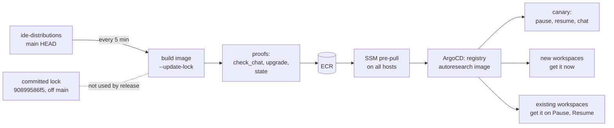
Figure 14 — The release path for IDE profiles. The lock file matters only for manual builds.

Three facts about what is actually running:
- **No smoke-test gate.** This repo's `docs/hosting.md` expects a smoke test before the lock advances. That
  gate does not exist: **every merge here reaches new IDE workspaces within minutes.**
- **The lock is off `main`.** The committed lock pins ide-distributions `90899586f5`, a commit on PR #30's
  branch, not on `main` (`metta/devops/hermes-fleet/applications/autoresearch/ide-distributions.lock.json`).
  Today the only difference in the profile trees is a test fixture, but the lock does not track `main`, so
  manual builds and production can drift apart.
- **Release runs failed on 10-22** from 09:16 to 11:31 PDT, at the host-install and verify step (an ArgoCD
  job hit its retry limit); Datadog's "[IDE] Hermes Release Job Failed" fired twice. A later run succeeded by
  reusing an already-published tag. Which profile commit each workspace runs cannot be read from the repo.

**Models.** Production sets every autoresearch profile to `openai/gpt-6-luna`
(`metta/devops/app-manifests/values.yaml:596-650`), while the distributions default to `moonshotai/kimi-k3`.
Since metta #28612, each `/ide-next` or `/ide-final` chat turn sends the user's chosen model, Haiku 5.5 by
default (`lib/hermes/chat.ts:390-402`). So the orchestrator answers chat on one model and handles task
notifications and cron wakes on another, and the researchers stay on `gpt-6-luna`.

### 5.3 Life of a profile change

- What reaches an existing workspace depends on the kind of file. SOUL, skills, plugins and cron follow
  Hermes's distribution update. `config.yaml`, `.env` and memories are durable and kept.
- A change to the set of profiles (names or count) cannot be adopted. It needs a migration.
- An image that introduces the coordinator refuses to start over unfinished old tasks.

On first start, the supervisor installs each profile with `hermes profile install <src> --name <n>
--yes`, then sets the model, approvals and working directory (`observatory_hosted_worker/runtime.py:113-158`).
On later starts, an image-only change runs `hermes profile update <name> --yes` (`runtime.py:119-136`).
Every start then runs `prepare.py` (`metta/devops/hermes-fleet/applications/autoresearch/prepare.py`):
- link image assets and write the `RESEARCH_*` `.env` values, including `RESEARCH_EPISODE_LIMIT` (default
  200), and configure the shared episode budget (`prepare.py:28-45`, `:97-108`);
- add `workspace integrate`, `workspace publish` and `softmax upload` to `approvals.deny` on every profile
  with the researcher guard (`prepare.py:76-96`);
- on the orchestrator, add the `memory` toolset (metta #28448; `prepare.py:110-128`);
- rewrite the `supervisor` cron job to the model-free gate script (`prepare.py:129-159`);
- apply the Kanban settings on every start: dispatch in the gateway, no automatic decomposition, one task
  per researcher, the worker profiles, and no default assignee (`prepare.py:160-179`);
- once only: create the board and resume `supervisor`; bootstrap only if the workspace has no `.git`.

**The coordinator adoption gate.** When a workspace resumes onto an image whose orchestrator ships
`coordinator.json` and its saved profile does not have one yet, startup refuses if the board holds any task
that is not done or archived: "Coordinator adoption is blocked by active legacy tasks. This workspace will
remain stopped. An operator must restart the previous image…"
(`metta/packages/observatory-hosted-worker/src/observatory_hosted_worker/layout.py:80-93`). A user's ordinary
Pause and Resume can therefore leave the workspace stopped. How often this happens is unknown.

The durable-state table (`metta/devops/hermes-fleet/applications/autoresearch/STATE.md:10-26`) lists
what survives: `state.db` (conversations), `kanban.db`, the bridge state, the canonical git
repositories and workspaces, root and profile `config.yaml`, `.env`, memories and sessions. It replaces
`/opt/hermes`, `/opt/ide-distributions/*` and the profile venvs.

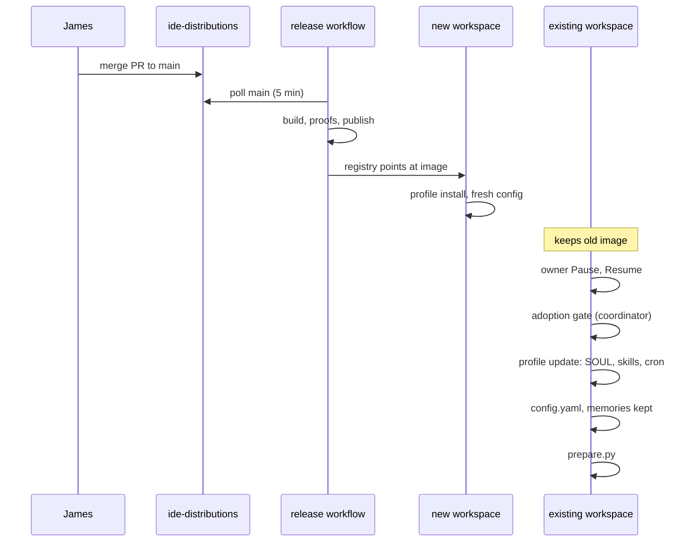
Figure 15 — Life of a profile change. A config change reaches existing workspaces only if metta's
`prepare.py` sets it explicitly, as it does for the deny list, `memory` and the Kanban settings.

Before merging a profile change:
1. If you changed `shared/` or `ontology/`, run `tools/sync_shared.py` and commit the copies too.
   Then run each distribution's tests (`uv run pytest -q` in the folder); CI now also installs the
   orchestrator profile into a real Hermes (`.github/workflows/ci.yml:47-51`).
2. If `config.yaml` changes, ask whether existing workspaces need the change. If they do, metta's
   `prepare.py` must set it.
3. Don't rename, add or remove profiles without a migration plan.
4. Treat a new `cron/jobs.json` entry as a hosting-cost decision (§5.4).
5. Because merges ship within minutes, test risky changes in a personal workspace first. The documented
   loop is the retained EC2 dev loop with brokered test accounts
   (`metta/packages/softmax-ide/docs/ec2-development.md`; metta #28062).

### 5.4 Workspace lifecycle

- A workspace provisions in up to 12 minutes, is "connected" while the bridge has reported within 90 s,
  and drains on Pause without ever being forced.
- Each user can hold one IDE workspace and, separately, one Play workspace, possibly on the same cogent.
  `/ide-next`, `/ide-final` and `/ide` share the IDE one.
- Idle sleep after 15 minutes exists, but never happens for IDE workspaces.

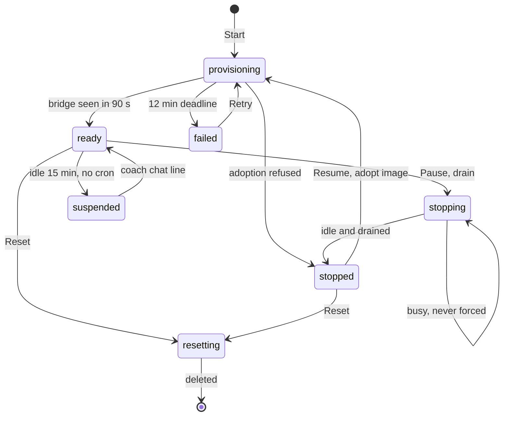
Figure 16 — Workspace states, from
`metta/workspaces/observatory/platform/api/src/observatory_api/routes/app/v2/cogents/hermes/service.py` and
`observatory_hosted_worker/fleet.py:134-539`. For IDE workspaces, the idle-suspend edge never fires.

Points that matter for the profiles:
- **IDE workspaces never sleep.** The lifecycle check counts any `cron/jobs.json` with entries as
  scheduled work: "Future scheduled work cannot yet wake a sleeping EC2 workspace. Keep such profiles awake"
  (`observatory_hosted_worker/lifecycle.py:116-140`). The orchestrator still ships `supervisor`, now as a
  model-free script, so each IDE workspace holds one of two slots on its server until the owner pauses it.
  Rohit's open metta #28685 would let these workspaces sleep after 15 idle minutes and wake on a message, a
  command or a due job.
- **Pause drains and never forces.** A running researcher task blocks the pause. Live, the header Pause gave
  up after 90 s without naming the task, and the UI went dark meanwhile (M22). Metta #28550 lets Resume
  cancel a drain.
- **One workspace per cogent and application** (metta #28599). Workspaces are keyed by player and
  application. Runtimes listed in `HERMES_SEPARATE_RUNTIMES` (in production, only `play`) are their own
  application; everything else, including no runtime at all, is `ide`. A user may hold one workspace per
  application; a second IDE start on another player gets 409 "Only one hosted player per user is supported"
  (`hermes/service.py:420-423`). `/ide-next` and `/ide-final` start and adopt with no runtime selector, so
  they always get the IDE workspace (`lib/workspace-start.ts:24-63`).
- **Waking from `/ide-next` is unclear.** Only coach chat lines wake a suspended workspace, and `/ide-next`
  refuses to send while the workspace is not connected (`lib/hermes/ec2.ts:31-32`; `fleet.py:221-239`). This
  is inferred, and moot while IDE workspaces never sleep.
- **Changing the researcher count** changes the profile set, so retained workspaces need a migration
  (`metta/workspaces/observatory/platform/api/src/observatory_api/clients/hermes/ec2.py:291-295`). The runtime
  definition now takes `--researchers N`.

### 5.5 Hermes patches carried by metta

- Metta patches upstream Hermes six times. The orchestrator depends on two of the patches.

The patches, in `metta/packages/observatory-hosted-worker/patches/`:
- failure classes in run results;
- a stable operation ID across LLM retries;
- credential refresh on every request;
- current task state in Kanban failure wakes;
- a Kanban cancel that confirms the worker is dead before releasing it;
- since 10-22, the coordinator inbox (§4.4).

The orchestrator's doctrine relies on the fourth ("Read `card_show` before recovering a failure",
`orchestrator/SOUL.md:38`) and entirely on the sixth.

---

## 6. Mismatches between the profiles and the IDE

- The biggest gap is structural. `/ide-next` was designed around **IDE-owned tools over MCP**: approvals,
  the journey, goals, continuations and `research_delegate`. The hosted orchestrator never had them, and
  since 10-21 their server no longer exists. Yet every hosted turn still tells the orchestrator to use them.
- The profiles keep their research state, champion, pause and budget where no UI can see it.
- Items are numbered M1–M24 so §6.6 and §8 can cite them. Items tested live on 10-21 carry a **Live** note.
  Live tests predate the 10-22 coordination redesign, which changed some behavior (§7).

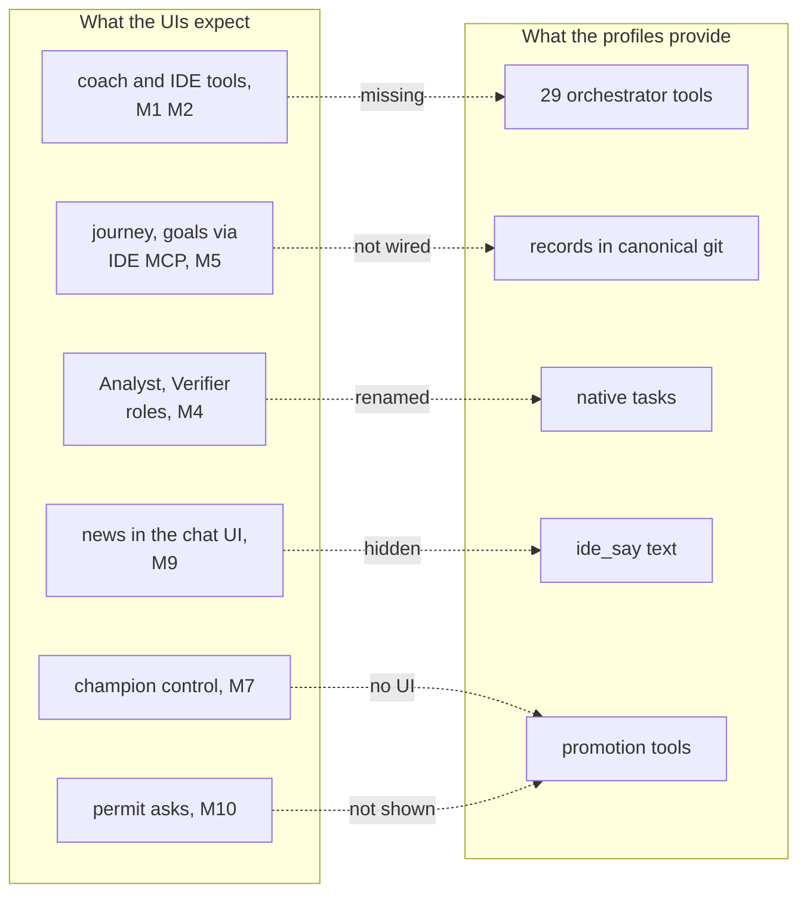
Figure 17 — Where the UIs' expectations and the profiles' capabilities fail to meet. Labels refer to the
items below.

### 6.1 The UI asks for things the profiles don't have

- Every hosted turn carries instructions that are wrong for the orchestrator, and one chip fails outright.
- Whole features stay empty against the hosted agent.

1. **M1. Stale tool instructions on every hosted turn.** `/ide-next` adds "Use the installed coach tools and
   their proposal/confirmation protocol. Only the human can confirm a proposal" (`lib/hermes/chat.ts:363-364`).
   The coach tools were retired with metta #28046, and the orchestrator has none. Each turn also carries the
   client's `canvasInstructions`, `templateSetup` and a `presentation.requestToken`, which tell the agent to
   use `compose_workspace`, `create_view`, `present_view` and `research_journey`
   (`components/workspace/request-workspace.tsx:70-72`, `:626-634`). Those were IDE tools, and their server was
   deleted on 10-21. `/ide-final` sends the same text, which now also contradicts the real `ide_workspace` tool
   (§8.3). The next hosted line, about delegating research on this VM, is accurate and worth keeping
   (`chat.ts:366-368`). **Live:** the orchestrator searched its tool catalog for "workspace create view presentation
   requestToken" and "shared workspace research journey inspect". Each search returned "no lexical matches"
   and its 24 tools of the time.
2. **M2. "Improve my policy" sends a recipe built on IDE tools.** The `research` mode's instructions name
   `game_contract`, `game_workspace`, `container_policy_*`, `research_journey`, `research_delegate`,
   `research_status`, `hosted_xp_wait` and others (`lib/workspace/coding-workspace.ts:8-12`;
   `lib/workspace/composer.ts:13-21`). None exists for the hosted orchestrator. **Live:** the chip fails
   outright. The orchestrator stopped and replied: "I couldn't test a teamfight improvement in this session:
   the required GotA contract, policy-workspace, researcher-delegation, and hosted-XP tools aren't available
   here… Please retry in a session with the GotA research tools enabled." It made no task, and the Research
   journey tab stayed at "Waiting for the first research checkpoint".
3. **M3. The chips mean nothing to the profiles.** The four modes reach the orchestrator only as hint text.
   The SOUL once defined chat commands, but no UI sent them and #30 removed them (§3.3). Appendix E records
   James's proposal: workflows defined in the profiles, which the chips select.
4. **M4. The Agent workflow panel uses `/ide-mvp`'s roles.** It labels tasks Analyst, Researcher or Verifier,
   with kinds `analysis`, `edit` or `verify` (`components/workspace/hermes-research.tsx:121-124`). Hosted tasks
   have no kinds and go to `researcher-1` and `researcher-2`. **Live:** while task #1 ran, the panel said
   "No agents running". Later it listed the tasks as "Subagent".
5. **M5. Research journey, goals, continuations and approvals stay empty.** Only IDE tools wrote them, and goals
   are off on hosted by design (§3.1). The profiles record findings as claims, results and journals in
   canonical git, which no UI reads.

### 6.2 The profiles have things the UI doesn't show

- The research record, promotions, the research pause and the episode budget have no UI.
- Background news and permit asks never reach `/ide-next` or `/ide-final`.
- The coach's standing rules never reach the profiles.

6. **M6. Research records.** Topics, hypotheses, experiments with decisions, results with confidence
   intervals, claims, hubs and lessons all live in canonical git inside the container, and no UI reads them.
7. **M7. Champion and promotion.** The orchestrator owns `promotion_submit`, `submit_requested_version`,
   `bootstrap_champion`, `accept_champion` and champion-conflict handling, but no IDE surface shows the
   champion or offers a release control. **Live:** the orchestrator found a champion conflict and called
   `control_write(pause)`. After "Yes, accept…" it called `accept_champion` (promotion
   `P-01M5FVK6T1GTB9GNRG88X9EYSH`), then `control_write(resume)`, `plan_write` and `card_create`. Only chat
   prose showed any of it.
8. **M8. Pause research.** `control_write(pause)` stops new research. The UI offers two other pauses: an account
   research pause, built for Vercel sandboxes, and the workspace pause (metta #28471). Neither reaches the
   orchestrator's `control/pause.json`. **Live:** "Check account status" returned
   `{"paused":false,"drained":false}` ("Account admission is open") while a researcher task ran.
9. **M9. Background news is invisible.** `ide_say` lands in the cogent's chat log, which neither IDE surface
   reads. The wake reply lands in the chat that created the task, or, for a cron wake, in the session the
   orchestrator stored last (§4.2). **Live:** task #1
   completed at 11:51 PDT. The orchestrator posted "Role baseline update: …" with `ide_say` into the original
   chat, and the `/ide` room showed it. The `/ide-next` chat that asked for the work showed the raw wake text
   "[kanban] Task t_8b9ac894 completed…", then the internal reply "Event reported and acknowledged.", then the
   UI's own task notice.

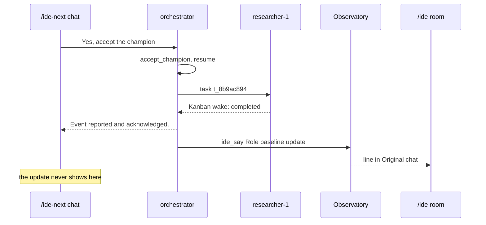
Figure 18 — The news path seen live on 2026-10-21, before the coordinator inbox. The `/ide-next` user saw the
internal wake reply. The real update went only to the `/ide` room.

10. **M10. Permit asks are invisible.** When a submit or a spend needs the coach's approval, the platform files
    an ask (§3.5), and the agent waits. A search of `metta/packages/softmax-ide` for `asks` or permits finds no
    reader. So an `/ide-next` or `/ide-final` user cannot answer the ask that a hosted promotion or XP launch
    waits on. This is from code; no action in the live tests needed a permit.
11. **M11. The episode budget has no UI.** Each workspace has a shared ceiling on hosted episodes, 200 by
    default, which only the orchestrator can lower and only `status` reports (§3.3). A user cannot see or set it.
12. **M12. Coach rules are never read.** Neither profile reads `profile/coach`, so cadence, reasoning and
    `dailyCredits` preferences don't reach the hosted agent. Only the platform's permit check uses `askBefore`
    (§3.5).

### 6.3 Shared words, different meanings

- Goal, experiment, draft, chat and team shape all differ between the UIs and the profiles. §3.6 has the
  picture.

13. **M13. Goal, experiment and draft.** Each means something different in each surface (Figure 6), and none
    has an ontology entry. Goals never reach the profiles, and the IDE's "experiments" are only XP rows.
14. **M14. Chat with researcher.** This opens an owner discussion on a researcher profile whose SOUL says
    "Talk to the coordinator, not users" (`researcher/SOUL.md:32`). **Live:** it works; the researcher gave a
    useful status answer with `ar://evidence/…` references.
15. **M15. Team shape.** The panel's labels assume analysts, a researcher and a verifier. Hosted runs a
    coordinator and two researchers. Mason runs one mind with workers.

### 6.4 Bugs and drift in the profiles

- One production bug stalls promotions.
- Four smaller issues can be fixed in this repo alone.

16. **M16. The permit read path is broken in production.** The shared client reads
    `{COGAMES_API_URL}/v2/cogents/{player}/c/asks/{key}` (`shared/ide_research_core/softmax_tool/client.py:84`).
    Hosting sets `COGAMES_API_URL` to `https://softmax.com/api` (`observatory_hosted_worker/runtime.py:270`,
    `:284`). On 2026-10-21, `https://softmax.com/api/v2/cogents/...` returned the website's 404 HTML page, while
    `/api/observatory/v2/...` returned the API's 401 JSON. `permit_answer` therefore returns nothing, and a
    promotion waiting on a permit never moves forward. The cron gate's own permit read uses the correct
    `/observatory` prefix (`orchestrator/src/orchestrator/ide.py:23`, `:56-57`), so the wake fires, but the
    promotion still cannot read the answer. Still unfixed at `ed1ded5`.
17. **M17. No researcher roster.** The old "Use named assignees such as researcher-1" line is gone, and the SOUL
    now says "You coordinate N researchers" (`orchestrator/SOUL.md:3`). But no tool lists the researchers, and
    `card_create` requires an `assignee` (`orchestrator/src/orchestrator/plugin.py:97`). Metta sets the
    dispatcher's worker list without telling the orchestrator (`prepare.py:162-168`). **Live (before #30):**
    three tasks in a row went to researcher-1 while researcher-2 sat idle.
18. **M18. `experiment/SKILL.md` contradicts ide-distributions #23.** It still forbids using a performance
    guardrail as a primary metric (`researcher/skills/autoresearch/experiment/SKILL.md:56-57`, `:109-110`),
    which steers GotA researchers away from `glory`.
19. **M19. Metta patches the orchestrator config at start.** It adds the `memory` toolset to `api_server`
    (metta #28448); this repo ships `api_server: [orchestrator]` (`orchestrator/config.yaml:11`).
20. **M20. Stale `ide_workspace` guidance and errors.** The SOUL says "If the tool returns `unavailable`,
    explain that workspace integration is not configured" (`orchestrator/SOUL.md:94`), but #24 as merged can no
    longer return that. An HTTP error from the IDE endpoint is reported as "cogents API returned HTTP N",
    because the plugin's shared handler names the cogents API (`orchestrator/src/orchestrator/plugin.py:316`).
    Open ide-distributions #32 reworks this tool's discovery.

### 6.5 Platform and UI problems the profiles feel

- These are metta problems, but each one changes what the profiles can promise.

21. **M21. The IDE hides some tasks.** The Work board shows only tasks the orchestrator created from the user's
    IDE conversations in the selected league. Tasks created in an `/ide` chat, or during a cron wake whose
    stored session is an `/ide` chat, are absent (§3.1). Open ide-distributions #32 would record each task's
    exact originating run for the bridge.
22. **M22. Pause hangs while a task runs, and the UI goes dark.** **Live:** Pause went to "Pause pending", then
    at 100 s to "Pause blocked: work or delivery has not drained after 90 seconds… Send /stop to cancel a known
    live chat run, or resume to reopen admission." The UI never named the blocker, a running researcher task,
    and `/stop` does not apply to tasks. During the drain the chat showed "Conversation status unavailable",
    the Work board "The work board is unavailable", and the agent panel "Agent status unavailable". Resume
    recovered in 10 s, and a message sent during the drain was kept and delivered. Metta #28550 lets Resume
    cancel a drain; the UI still does not name the blocker.
23. **M23. An image update can leave a workspace stopped.** The coordinator adoption gate refuses to start over
    unfinished old tasks and waits for an operator (§5.3). Nothing in the UI explains this.
24. **M24. One queue for everything.** Because all orchestrator turns are serialized (§4.4), a user's message
    waits behind any running background turn, and cron-wake results can land in a different chat (inferred,
   not tested).

### 6.6 Action plan

- **Fix now in this repo**: cheap, profile-only, no coordination.
- **Needs a UI or platform change**: one side cannot finish alone.
- **Needs a decision**: product or ownership calls, with a suggested owner.

**Fix now in this repo** (suggested order):

| Order | Item | Change | Impact |
|---|---|---|---|
| 1 | M16 | Add the `/observatory` prefix to the shared client's `ASK_PATH`, test against the hosted URL shape, then run `tools/sync_shared.py` | High: unblocks promotions that wait on permits, and Phase 2 of Rohit's plan (§8.4) |
| 2 | M17 | Give the orchestrator its researcher roster, for example through `status` or the `SOFTMAX_WORKER_PROFILES` list, and tell it to spread work | High: up to twice the research throughput if the skew seen on 10-21 persists after #30 (untested); slows Phase 1 of Rohit's plan |
| 3 | M9 | Stop sending `ide_say` news nobody sees: drop the tool, its SOUL line (`orchestrator/SOUL.md:82-83`) and the cron wake prompt's instruction (`gate.py:101`), or send it with the originating `session_id` once an IDE surface reads it | Medium: fewer wasted turns; honest instructions |
| 4 | M20 | Remove the `unavailable` sentence; give `ide_workspace` failures their own error text | Low |
| 5 | M18 | Update `experiment/SKILL.md` for ide-distributions #23 | Medium: GotA experiments can use `glory` |
| 6 | M19 | Ship the `memory` toolset in this repo's config | Low: metta can drop its patch |
| 7 | M14 | Give researchers a rule for owner discussion sessions | Medium: "Chat with researcher" is live |
| 8 | Doc drift | Refresh `docs/hosting.md` and the orchestrator and researcher READMEs (Appendix C) | Medium |

**Needs a UI or platform change** (profile side and UI side):

| Item | Profile side | UI or platform side |
|---|---|---|
| M1, M2 | Keep the SOUL as the only tool guidance | Remove the "coach tools" line, `canvasInstructions`, `templateSetup`, `presentation.requestToken` and research mode's IDE-tool recipe from hosted turns (`chat.ts`, `composer.ts`, `coding-workspace.ts`, `request-workspace.tsx`) |
| M3 | Define the chip workflows in the profiles (Appendix E) | Send the workflow name instead of a recipe |
| M4, M15 | (none) | Show native assignees, not Analyst/Verifier roles |
| M5, M6, M13 | Mirror topics, experiments and decisions to cogent records, the way the bridge mirrors tasks | A view for findings, experiments and decisions |
| M7, M8, M11 | (none) | Show the champion, the research pause and the episode budget; buttons for pause and release |
| M9 | Send news with the originating session | Read the cogent chat log, or show wake replies in the chat that asked |
| M10 | (none) | Show the cogent's `asks` with Yes/No, as `/ide` does |
| M12 | Read `profile/coach` and add a SOUL rule for cadence and reasoning | Settings for those rules in the IDE |
| M21 | (none) | List all workspace tasks, not only those from IDE sessions |
| M22, M23 | (none) | Name the work that blocks a Pause or an update, and let the user wait or cancel; keep the chat and the board readable while draining |

**Needs a decision:**

| Question | Items | Suggested owner |
|---|---|---|
| Which primitives do we keep? James asked on 10-21 for a discussion to "solidify the initial primitives" | M3, M13, Appendix E | James, Rohit, Mason and Aaron |
| Keep the supervisor cron awake, or take #28685's idle sleep? | §5.4 | James and Rohit |
| Team shape and goal model before porting more of Mason's client: one mind or a team; neuron goals or topics | M15, §8.2 | James, Mason and Aaron |
| Does `ide_say` survive if `/ide` is retired, or does all news go through chat replies? | M9 | James and Rohit |
| How does the website reach source in the user's container, given that the bridge is outbound only? | §8.4 point 2 | Rohit, with James |
| What happens to Aaron's #28101 now that `/ide-mvp` is retired? | §2.3 | Aaron and Rohit |

---

## 7. What live testing showed

- On 2026-10-21, from 11:27 to 12:00 PDT, we used the live IDEs as James, at metta `7737474bf3`.
- The tests confirmed most of §6; each confirmed item carries a **Live** note there.
- They ran **before** the 10-22 redesign. The coordinator inbox, the removal of the gate's model and
  `event_ack`, and the per-turn model choice all changed since, so the news path, task routing and latency
  may now behave differently. The stale instructions (M1, M2) are unchanged and would still fail.

The evidence is in `.reports-working/ide-ux-system-map-2026-10-21/notes-live-exploration.md`, with the
request bodies in `live/` and screenshots in `shots/x-*.png`.

### 7.1 What worked

From the `/ide-next` chat, the research loop did what the profiles intended:
- The orchestrator saw that the league champion (`james-botts-gota-strategy:v47`) was not in its records,
  paused research, and asked the user. After "Yes, accept…" it accepted the champion, resumed, wrote a plan
  and made a task (M7).
- A typed `task:` line made a task in one turn. That command no longer exists; a plain request should now do
  the same.
- The Work board showed tasks #1–#3 in their columns.
- "Chat with researcher" answered with evidence references (M14).
- Resume recovered a hung Pause within 10 s, and a message sent during the Pause was delivered after Resume
  (M22).

Not tested: permit asks (M10), idle sleep, the permit-read 404 end to end (M16), and `ide_workspace` from a
real hosted turn.

### 7.2 What failed

- "Improve my policy" failed outright (M2).
- The orchestrator searched for IDE tools it never had (M1).
- Background news went only to `/ide` (M9, Figure 18).
- All three tasks went to researcher-1 (M17).
- Pause hung and the UI went dark (M22).

Two smaller observations:
- Most tool calls in the `/ide-next` transcript showed only as "Other actions · N" with unlabeled "tool call"
  rows. Tool search showed as "Found the next research tool".
- `/ide-mvp` login returned a Cloudflare 502 at 11:40 and 11:57 PDT. Since then it has been retired (HTTP 410).

---

## 8. `/ide-final` and Rohit's delivery plan

- On 10-21 at 13:47 PDT Rohit moved Mason's IDE into metta as `/ide-final` and asked Mason's agent to critique
  his delivery plan, now committed as `metta/docs/specs/0144-ide-final-gaps-and-delivery-plan.md`.
- By 10-22 `/ide-final` is live, and ide-distributions #24 gave the orchestrator `ide_workspace`. A real EC2
  agent edit has still not been proven.
- The plan's direction is sound: reuse the canonical research repository, the native task board and existing
  receipts, and add no new scheduler. It still misses five known problems: the stale instructions (M1), the
  outbound-only bridge, the permit read (M16), the news path (M9) and the roster (M17).

### 8.1 Status

| Change | Status | What it does |
|---|---|---|
| metta #28522 | Merged 10-21 13:52 PDT | Imports Mason's component library under `packages/softmax-ide/ide_final/` |
| metta #28525 | Merged 10-21 13:52 PDT | The `/ide-final` GoTA workspace, the shared SDK in `lib/ide/`, the MCP endpoint and one migration |
| ide-distributions #24 | Merged 10-21 15:56 PDT | The orchestrator's `ide_workspace` tool, calling `softmax.com/ide/mcp` |
| metta #28586 | Merged 10-21 | Builds both images from one revision and publishes `/ide/mcp` |
| metta #28623, #28649 | Merged 10-21 | Draft refresh without lost edits; Pause and Resume on `/ide-final` |
| metta #28583 | Merged 10-21 14:54 PDT | Retires `/ide-mvp` and the IDE's own MCP routes |
| metta #28801–#28805 | Open drafts, 10-22 | Durable IDE source, adapters for Mason's typed requests, Mason's full application, the Minion Rush tutorial |
| ide-distributions #32 | Open, 10-22 | The profile half of that stack: `ide_workspace_schema` discovery through MCP, an instruction to read the IDE league and schema before editing, and each task's exact originating run for the bridge |

GitHub shows a PR that Graphite's merge queue merged as "closed", with no merge date. Every "merged" claim
here was checked against `git log origin/main`, and the times are commit times on `main`.

**#24 as merged differs from the version critiqued on 10-21.** `SOFTMAX_IDE_URL` and the `kind: unavailable`
result were removed. The tool now derives `https://softmax.com/ide/mcp` from the existing `COGAMES_API_URL`
(`orchestrator/src/orchestrator/workspace.py:12-24`), as the spec's Phase 0 asks
(`metta/docs/specs/0144-ide-final-gaps-and-delivery-plan.md:149-167`). Each tool call still sends three
POSTs (`initialize`, `notifications/initialized`, `tools/call`; `workspace.py:43-77`). The spec says to
qualify the endpoint before merging the distribution change. #24's description records an API-level
qualification of `/ide/mcp` on 10-21 (draft and layout saves, revision 0 → 1), but no EC2 or model-driven
proof, and it merged before that proof.

**Slack since the plan.** Mason replied that his agent "thinks its great" and asked two questions that are
still unanswered: "are you suggesting using hosted version control for drafts?" and why "custom and HTML
based tabs/pages would be hidden behind a flag" (IDE group DM, 10-21 14:27). Aaron asked for a game-agnostic
orchestrator and opened metta #28573 and ide-distributions #25, both merged. Rohit said he would
"un-over-engineer some stuff i landed today" (10-21 20:45); ide-distributions #30 followed on 10-22.

### 8.2 What came from Mason, and what is coming

| Mason's piece (§2.3, §3.4) | In `/ide-final`? |
|---|---|
| JSON view of first-party components, and Edit mode | Yes. This is the core of #28522 |
| Component catalog with search and describe | Yes, given to the agent through `ide_workspace` |
| Policy workspace tabs (Info, Code, Discovery, Goal loop, R/L loop, Custom) | Not yet; #28804 mounts them |
| Draft ("the policy is what was submitted") | Renamed: here a draft is a title and notes; Phase 1 of the plan makes it "identify and edit real source" |
| Neurons, links, findings, goals with a gateway loop | Not yet; #28801 adds "measured-goal operations" |
| Sticky per-policy researcher | No; the hosted researchers stay as they are |
| Character, mood, mind panel, voice | Not yet; #28804 mounts "agent views" |
| His own agent gateway | No. `/ide-final` uses the hosted Hermes workspace |
| Minion Rush tutorial | Not yet; #28805 |

Most of Mason's measurement primitives have a close relative in the profiles' records, but none are exposed:

| His primitive | Closest profile concept | What would be new |
|---|---|---|
| Neuron (measured metric, readings per version with n and sd) | `GAME.md` outcome metrics (`glory`, `win_rate`, …); Result metrics with confidence intervals | A per-version reading series; user-named metrics; a "measure" tool |
| NeuronLink (raises or lowers) | Hypothesis lever and prediction; Claim kind `mechanism` | Edges between metrics |
| Finding (topic, edge, confidence, evidence) | Claim (kind, status, confidence, evidence) | Mostly an export: claims stay in git |
| Researcher (sticky per policy) | `researcher-N` per task; memory lives in canonical git | Per-policy continuity is in git; per-session memory is not |
| Goal (target on one neuron; gateway checks rounds) | Topic (objective, metrics, guardrails, `achieved`); experiment decision rule | A controller that loops until met, outside the model |
| Goal round (one change, upload, compare, record) | A build task, `upload_build`, an XP task, a review task | Close match |
| Draft and test builds | Version records with `uploaded` and `submitted` events; champion | Close match |

### 8.3 Old problems that `/ide-final` keeps

`/ide-final` reuses the `/ide-next` chat path and the same hosted workspace, so most of §6 applies unchanged:
hidden news (M9), hidden permit asks (M10), the roster (M17), hidden tasks (M21) and the failing research chip
(M2) if it keeps that chip. Two items change:
- **M1 now conflicts with a real tool.** `RequestWorkspace` still sends `canvasInstructions`, which say to use
  `compose_workspace`, `research_journey`, `create_view` and `present_view` (`components/final/workspace.tsx:314`;
  `request-workspace.tsx:70-72`). The SOUL says to use `ide_workspace` for layout changes
  (`orchestrator/SOUL.md:85-94`). The model gets two instructions for the same request, and one names tools
  that do not exist.
- **M22 is partly addressed.** Metta #28550 lets Resume cancel a drain, and `/ide-final` now has the Pause and
  Resume buttons. The UI still does not name the blocker.

### 8.4 A critique of the delivery plan

- **What the plan gets right.** One draft per owner. The canonical research repository as the only source of
  truth, with no second mutable copy. No new schedulers, queues or locks until a test shows a need. These
  match how the profiles already work: task worktrees, guarded integration and receipts.
- **What it misses.** Five gaps follow. Each is a known problem in this report, and each blocks or slows one
  of the plan's phases (Figure 19).

**1. Phase 0 must also remove the old canvas instructions** (M1, §8.3). The plan's proof is "a real agent
changes the intended owner's UI". In our live test, the same text sent the orchestrator into `tool_search`
loops. Make Phase 0 drop `canvasInstructions`, `templateSetup` and `presentation.requestToken` from the
hosted context, or replace them with one line that names `ide_workspace`.

**2. Phase 1 has no path from the website to the source.** The canonical repository lives inside the user's
gVisor container, and the bridge makes only outbound connections (Figure 7). So the website cannot read or
write source files directly. The plan says to "inspect existing file access before adding an endpoint". The
existing paths are the request and response records and the bridge's outbound poll, both built for chat
turns. This is the plan's largest design question. Rohit's draft #28801 ("durable IDE source") may answer it;
we have not reviewed it.

**3. Phase 2 already has an authorization boundary, and it is broken.** The plan asks "what counts as
publication?". The profiles already gate submission on a platform permit the coach answers (§3.5). But the
promotion path's permit read gets a 404 in production (M16), and the IDE does not show the asks (M10). Make
Phase 2 start from that permit, after M16 is fixed, instead of a new "publication intent".

**4. Phase 4's "native completion notifications" can go to the wrong place.** Task results return to the chat
that created the task, but cron-wake results (XP, credits, permits) reach the session the orchestrator stored
last, and tasks created during a cron wake belong to that session too. `ide_say` reaches only `/ide` (M9,
§4.2). Phase 4 must define which chat a result belongs to. Otherwise "close the browser, reconnect, and
retrieve the original outcome" can pass with the wrong text, or in the wrong chat.

**5. "One active source-editing task" needs the roster fix.** No tool tells the orchestrator which researchers
exist (M17). With one source-editing task per draft, other work queues behind it unless the orchestrator
spreads tasks correctly. The serial coordinator inbox (M24) adds its own wait.

The draft also duplicates records that exist. The orchestrator keeps topics (objective, metrics, guardrails),
a plan, hypotheses, claims and the champion in canonical git (§3.3). The plan's own open question 2 says to
"preserve the research repository's domain records". Then the draft's direction notes should point to topics
and the plan, not repeat them; otherwise the coach edits notes the orchestrator does not treat as its plan.

Smaller points on `ide_workspace`:
- Each tool call starts a new MCP session (three POSTs). The server's 30-second identity cache keeps the
  `/whoami` cost low, but initializing once per process is simpler.
- The hosted orchestrator finds tools by lexical `tool_search` (M1). Phase 0's check of "automatic tool loading"
  should include a search for words a coach uses, such as "layout" and "notes".
- GoTA scope is fixed in the server (`lib/ide/schema.ts:51-52`), while the orchestrator is now game-agnostic
  (#25). A second game needs a schema change, not configuration.

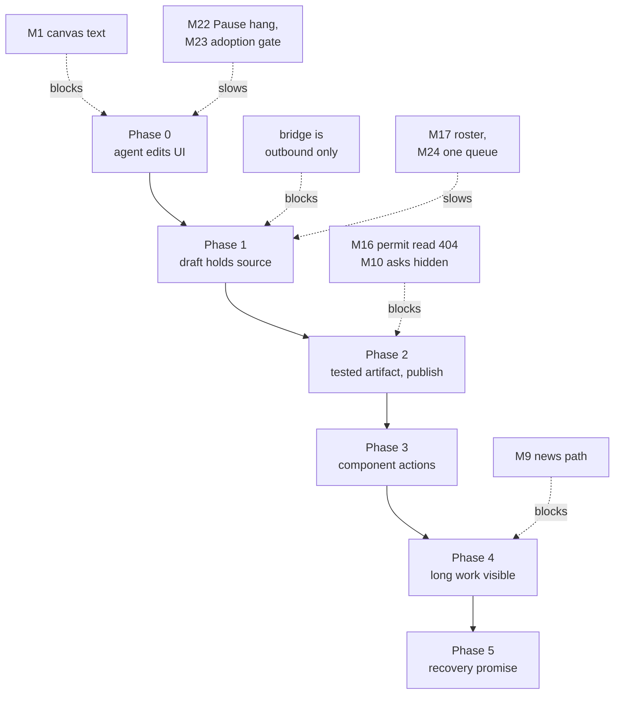
Figure 19 — Rohit's six phases, with the known problems from this report that block or slow each one.

### 8.5 What this means for the profiles

- **The profile fixes in §6.6 are prerequisites.** M16 (permit read) blocks Phase 2; M17 (roster) slows Phase 1.
- **`ide_workspace` needs a live proof.** No real hosted turn has edited a layout yet; that is Phase 0's gate.
- **Review ide-distributions #32 before it merges.** It is the profile half of Rohit's stack and changes
  `ide_workspace` and task lineage; like every merge here, it ships within minutes.
- **Mason's measurement primitives are coming through metta, not the profiles.** #28801's measured-goal
  operations will need a profile-side owner: either the orchestrator learns them, or they stay a UI feature.

---

## Appendix A: Glossary

- **Bridge**: the metta process beside Hermes in each workspace. It relays chat and requests between the
  Observatory API and the local gateway, and makes only outbound connections
  (`observatory_hosted_worker/bridge.py`).
- **Canonical repository**: one bare git repository per game in the workspace. Its `main` is the research
  record (`ontology/ONTOLOGY.md:10-20`).
- **Champion conflict**: the league shows a champion that the research loop did not record. Research that
  depends on the baseline pauses until the user decides (`orchestrator/SOUL.md:75-76`).
- **Chat request**: one `/ide-next` message, one turn, admitted to run in a conversation's Hermes session (§3.1).
- **Coach**: the human owner of a cogent, in the platform's vocabulary.
- **Cogent**: a player made addressable by agents. Agents read and write its records under
  `/v2/cogents/{player}`.
- **Coworld**: a Softmax game environment, such as Gods of the Arena or Pudge Wars, with its leagues.
- **Coordinator**: Rohit's name for the orchestrator since 10-22, the profile that owns the plan, the tasks,
  publication and the user.
- **Coordinator inbox**: the durable first-in, first-out queue that every orchestrator turn passes through
  (§4.4).
- **Draft**: three meanings. Mason: the policy as submitted to a league. `/ide-final`: the owner's title and
  notes, and later its source (§8). The profiles have no draft; they use version records and the
  champion.
- **Episode budget**: a per-workspace ceiling on hosted evaluation episodes, 200 by default (§3.3).
- **GoTA**: Gods of the Arena, the coworld the IDE targets today. The IDE code writes "GoTA" and the
  profiles' `GAME.md` writes "GotA"; they are the same game.
- **gVisor**: a sandbox runtime that gives each container its own kernel layer, isolating it from the
  host.
- **Hosted workspace**: one gVisor container per user and application on the shared EC2 fleet, running one
  Hermes gateway and a bridge.
- **KB hub**: a knowledge-base page in canonical git, "A present-tense synthesis page whose every sentence
  cites claims" (`ontology/ONTOLOGY.md:37`).
- **Neuron**: Mason's measured building block of a policy.
- **Permit**: the platform's request for the coach's approval before a submit or a spend, filed as an ask
  (§3.5).
- **Profile**: one named Hermes agent: prompt, tools, skills, config and memory.
- **Runtime (application)**: a named set of profiles plus an image in `HERMES_RUNTIMES`, for example
  `autoresearch`. Runtimes outside `HERMES_SEPARATE_RUNTIMES` all count as the `ide` application.
- **Task**: one native Hermes Kanban assignment to one researcher, on board `autoresearch`. The orchestrator's
  tools still call it a card.
- **Workspace**: five meanings, listed in §3.6. In this report it means the hosted workspace unless a section
  says otherwise.
- **Workspace request**: the saved UI document for one `/ide-next` screen (§3.1).
- **XP request**: an Experience Request, a hosted evaluation run paid for in credits.

## Appendix B: Open questions

- Each question has a suggested owner.
- "Blocks" marks questions whose answer changes profile work.

1. **Which primitives do we commit to?** Goal, task, finding, draft, workflow: James asked on 10-21 for a
   discussion "to solidify the initial primitives". *Owner: James, Rohit, Mason and Aaron. Blocks.*
2. **Does the hosted orchestrator have to serve `/ide` at all,** and does `ide_say` survive? *Owner: Rohit
   and James. Blocks.*
3. **Will Mason's gateway replace Hermes profiles,** or define a contract that Hermes implements? His plan
   asks "What's Hermes for, and should threads run on it?"
   (`masons-ide-explorations/docs/agent-platform-plan.md:369-371`). `/ide-final` runs his components on
   Hermes, and #28801–#28805 port more onto metta, but his goal loop and sticky researcher have no profile
   home. *Owner: Mason, Rohit and James. Blocks.*
4. **Should research records be mirrored to cogent records** so a UI can show them? *Owner: James. Blocks.*
5. **Which ide-distributions commit is each workspace running?** The committed lock pins a non-`main`
   commit, the release builds `main`, and some releases failed on 10-22. The image label records it.
   *Lookup: ArgoCD or ECR.*
6. **How often does the coordinator adoption gate leave workspaces stopped?** *Lookup: fleet status.*
7. **Is `scale_out_max_hosts` above 0 in production,** and how many slots are held by awake workspaces?
   *Lookup: Spacelift.*
8. **Should every profile get the full player credential?** Researchers can read it, and their deny lists are
   not a security boundary. *Owner: Rohit.*
9. **Mason's two questions on the plan are unanswered:** hosted version control for drafts, and why custom
   HTML tabs sit behind a flag. *Owner: Rohit.*

## Appendix C: Doc drift found along the way

- Drift in this repo can be fixed alongside §6.6.
- Drift in metta and Mason's repo is listed for whoever owns those files.

**`ide-distributions/docs/hosting.md`** (unchanged since 10-21):
- It doesn't say that its requirements R-1 to R-4 shipped (metta #28046).
- R-2 is wrong: the bridge serves Kanban controls through `kanban_profile`.
- R-6 still uses the old `/v2/.../say` path.
- It assumes a lock gate that the release does not use.
- It leaves out the model override, the cron cost, the coordinator inbox, `coordinator.json`,
  `SOFTMAX_BRIDGE_DIRECTORY` and `RESEARCH_EPISODE_LIMIT`.

**Elsewhere in this repo:**
- `orchestrator/README.md` calls the supervisor "an agent cron job" (it is `no_agent`), documents
  `workspace_integrate(branch)` (it now takes `id, run_id, commit`), omits `upload_build`,
  `submit_requested_version`, `budget_limit` and `ide_workspace` from its tool table, and still says it "leads
  research for one player/game".
- `researcher/README.md` still says the researcher's last step is `workspace integrate`, which researchers are
  now denied.
- `researcher/plugins/researcher_guard/plugin.yaml:3` still says "only `workspace integrate` pushes canonical
  main; completion requires a matching canonical journal". Neither is true now.
- `ontology/ONTOLOGY.md:16` and `researcher/README.md:22` still name branches `card/<id>`; Hermes now names
  them.
- `orchestrator/SOUL.md:94` describes an `unavailable` result that `ide_workspace` can no longer return (M20).
- `orchestrator/SOUL.md:58` says "Acknowledge events only after their actions succeed", while
  `ontology/ONTOLOGY.md:88` says "no separate acknowledgement is required" and no acknowledgement tool exists.
- `ontology/ONTOLOGY.md:18-19` still calls `research workspace integrate` "the only way a card's work reaches
  `main`"; it is now the coordinator's `workspace_integrate`, which researchers are denied. Both SOULs embed
  this text.
- `researcher/skills/autoresearch/candidate/SKILL.md:8` cites "design v4.4 §9", which may not exist in the
  HTML design (not checked).

**Other repos:**
- `metta/packages/softmax-ide/docs/hermes-mode.md:6-7` says "Eve still relays human chat messages". Eve,
  the IDE's earlier chat relay, was removed (metta #27719).
- `metta/devops/hermes-fleet/README.md:74` says releases "discard the fleet". Since metta #28240,
  they keep it.
- `masons-ide-explorations/docs/agent-platform-plan.md:3` says "Nothing here is built yet". Phases 0–1
  are built.

## Appendix D: Skills and tools by primitive

- Every researcher skill and orchestrator tool group is listed here, with the UI primitive it feeds.
- "None" means no IDE surface shows what the skill or tool produces.

| Skill or tool | Profile | Purpose | UI primitive it feeds |
|---|---|---|---|
| `card` | researcher | Execute a native assignment: stage work, then complete | Work board status |
| `report` | researcher | Report findings to the coordinator | None directly (the orchestrator relays it) |
| `replay-diagnosis`, `diagnose` | researcher | Find a cause in replays; turn it into hypotheses | None |
| `league-watch`, `opponent-profile`, `meta-recon` | researcher | Scouting: standings, one opponent, the meta hub | None |
| `experiment` | researcher | Design and pre-register an experiment | None (experiment records stay in git) |
| `build-upload`, `candidate` | researcher | Build a candidate and stage it for the coordinator to upload | `/ide-next` Experiments tab (as XP rows only) |
| `xp-request` | researcher | Launch or relaunch XP | `/ide-next` Experiments tab |
| `fetch-artifacts`, `ab-compare`, `review-xp` | researcher | Review XP and set the decision | None (decisions stay in git) |
| `kb-maintenance`, `lessons`, `calibrate-noise` | researcher | Keep the KB, lessons and noise records sound | None |
| GotA `ab`, `diagnosis`, `eval-design`, `replay-inspection`, `survey` | researcher | GotA-specific bindings of the above | Same as their general skills |
| `ide_say` | orchestrator | Background news | `/ide` only |
| `ide_task_update` | orchestrator | Update an IDE task | None |
| `ide_workspace` | orchestrator | Read and edit the `/ide-final` layout and draft | `/ide-final` page |
| `card_*`, `worker_skills` | orchestrator | Create, answer, comment on and close tasks | Work board |
| `records_*`, `plan_write`, `control_write`, `status`, `budget_limit` | orchestrator | Read records; write the plan, the pause and the budget | None |
| `upload_build`, `workspace_integrate`, `submit_requested_version`, `promotion_submit`, `bootstrap_champion`, `accept_champion` | orchestrator | Publication and promotion | None |
| `xp_status`, `credits`, `discover_leagues`, `league_players`, `game_support`, `leaderboard`, `latest_league_result` | orchestrator | Platform reads and discovery | Chat answers |

Sources: `researcher/skills/*/SKILL.md` descriptions; `orchestrator/plugins/orchestrator/plugin.yaml:6-34`;
`orchestrator/src/orchestrator/plugin.py:21-254`.

## Appendix E: Notes for future work

- These are James's notes from reading this report. They describe future direction, not the current system.

**Built-in workflows in the profiles** (on the four chips in §2.1). The IDE wants a set of ready-made
workflows beside free chat, and other IDEs will want the same. The profiles should hold these workflows. A
workflow must be quick to define, in code or in a very simple structured format. Coworld owners should be
able, or required, to supply ready-made responses or knowledge for a workflow. For example, a coworld can
come with a guide on how to teach it, for "Learn this game"; "Review the league" can resemble a recon skill.
The prompt then adds the workflow to the user's request: "The user probably wants this workflow. Here is their
request." With this, the IDE can have chips like these and add and test new ones easily. This connects to
M2 and M3: today the chips send IDE-tool instructions the hosted orchestrator cannot use. `game_support`
(#25) already loads a game's published guide, which is a natural home for per-coworld workflow knowledge.

**Fewer record types** (on §3.3). The ontology's ten record types (Topic, Hypothesis, Experiment, Result,
Version, Claim, Hub, Evidence, Journal and Lesson) are too many. Consolidate and reduce them.

**Define the missing words** (on §3.3). The ontology defines none of goal, news, priority, practice, release,
draft or workspace. Fix this as part of the same consolidation.

**Decide what the coach records are for** (on §3.5). Work out what `profile/coach` (cadence, reasoning,
credits, `askBefore`), `profile/soul` and the asks inbox are supposed to do, then make sure the ones we need
actually work end to end.

**Coaching** (on §3.5). Adding Aaron's replay coaching to the research loop is important future work.

## Appendix F: Sources

- The per-topic working notes, with full line citations, are in `.reports-working/ide-ux-system-map-2026-10-21/`.
- The numbered citation list follows; each body superscript links to it.

**Companion file:** `docs/reports/ide-ux-system-map-2026-10-21-primitive-inventory.md`, the independent Codex
primitive inventory (metta `2a69374811`).

**Working notes:** `notes-softmax-ide-package.md`, `notes-hermes-hosting.md`, `notes-profiles.md`,
`notes-mason-explorations.md`, `notes-slack.md`, `notes-meetings.md`, `notes-live-site.md`,
`notes-live-exploration.md`, `notes-rohit-mason-merge.md`, and the 10-22 refresh notes:
`notes-refresh-metta-2026-10-22.md`, `notes-refresh-profiles-2026-10-22.md`,
`notes-comment-answers-2026-10-22.md`, `notes-slack-refresh-2026-10-22.md`.

**Key documents:** metta `docs/specs/0144-ide-final-gaps-and-delivery-plan.md` (Rohit's delivery plan);
metta `packages/softmax-ide/docs/ide-final.md`; ide-distributions `docs/coordinated-research-acceptance.md`;
ide-distributions `orchestrator/README.md`.
