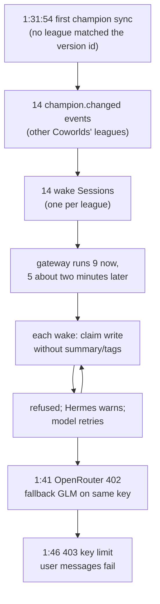
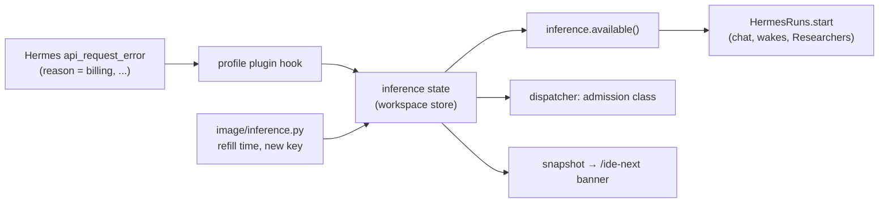

# Triage: the $10-in-27-minutes incident and its three Asana tasks

Triage briefing for James Boggs, November 2, 2026 (PST). Covers JAME-176 (runaway tool-call loop), JAME-175 (dispatcher error classes) and JAME-174 (budget-aware research serve). Researched at ide-distributions `2a224d2d`, metta `5a41cd9aa2`, and Hermes v0.21.6 source.

## Executive summary

The workspace's $10 key ran out in 27 minutes. The user's chat did not loop: it made 2 valid `claim` calls and cost about $1.00. About half the money, roughly $5.00, went to **14 Orchestrator wake Sessions** (background runs the watcher starts to handle one event each), all created in the same second. The watcher's first champion sync read every league on the platform, because no league matched the active Coworld's version id (`core/src/research_core/watcher/champion_sync.py:102-107`). The workspace was on Generals version 0.6.3. Generals has three leagues, but they follow the Coworld's canonical version, and each version has its own id. It reported 14 champions from other Coworlds as changes and started one wake per league. Each wake tried to record a claim, the model kept dropping the claim's `summary` and `tags`, and Hermes's loop guard only warned. One wake sent identical arguments 185 times. The setup wake, which is ordinary work, cost about $3.20, and the Researcher about $0.90. All 14 wake events are acknowledged, so unpausing workspace `58bda2da` starts nothing again.

The single budgeted key did its job as a hard cap. What all three tasks miss is a record of *why* model work cannot run now: every run start passes one gate, `inference.available()` (`core/src/research_core/watcher/hermes_api.py:265`), and that gate checks only the key's expiry. Recommendation: first, sync champions for the active Coworld only, merge champion wakes, and turn on Hermes's hard stop with a notice when it fires. Then add one shared record of why model work is blocked, written from Hermes's own error classes and read by the gate, the dispatcher and the IDE. Claims stay in the wake prompt. Making them reliable on mid-tier models is its own task, together with multi-model tool-call tests. **Not examined:** the Datadog logs, the Researcher Session's transcript (its cost is estimated as a remainder), and the Hermes build inside the image.

## Contents

1. What actually happened
2. Shared concerns across the three tasks
3. JAME-176: find and stop the runaway tool-call loop
4. JAME-175: teach the dispatcher what provider errors mean
5. JAME-174: make research serve aware of the budget
6. Recommended order and ticket changes
7. Open questions
- Appendix A: Per-Session evidence and spend
- Appendix B: Hermes and platform mechanisms referenced
- Appendix C: Sources

## 1. What actually happened

- **The chat Session did not loop.** `api_1793654344_5866fc18` made 2 `claim` calls, both `action=query`, and cost about $1.00.
- **The trigger was the watcher's first champion sync** at 1:31:54 PM. It emitted 14 `champion.changed` events, one per league, all for leagues in other Coworlds.
- **Each event started its own Orchestrator wake Session.** 9 began work at once and 5 about two minutes later, consistent with the Hermes gateway's limit of 10 concurrent runs.
- **The wakes made 357 `claim` calls**, 348 of them writes. 345 writes were refused for missing `summary` and/or `tags`; 3 succeeded.
- **One wake made 193 `claim` calls**, 185 with identical arguments. It cost about $3.00 on its own.
- **The money split roughly in thirds.** Champion wakes about $5.00, the setup wake about $3.20, chat and Researcher about $1.90 together (Appendix A).
- **The key ran out at 1:46 PM.** The user's next three messages failed with "HTTP 403: Key limit exceeded".

**Terms used in this report.** A *Coworld* is one game on the Softmax platform, and a *league* is a competition inside a Coworld; one Coworld can have several leagues. A *Player* is the user's platform identity, and a league's *champion* is the policy version that represents that Player in the league. The *Orchestrator* is the research-lead agent profile the user chats with. A *Researcher* is a worker profile that runs one Task in the background, and *Flint* is the free model Researchers use by default. The *watcher* is the Orchestrator's periodic job that syncs platform state and starts wake Sessions. The *lease* is the time-limited OpenRouter key the platform issues to a workspace, with a dollar limit. The workspace records the lease's expiry in a file named `.inference-lease`.

The task statements built their story from Datadog logs, which cut tool arguments short and do not name the Session. The ops route `session.messages` returns Hermes's stored messages with full arguments, `workspace.snapshot` lists every Session with the event that triggered it, and `run.get` returns each run's status and token usage. OpenRouter's activity report for the key gives the exact dollars per model. Together they show three causes stacked on each other.

**Many runs from one event.** `leagues_of` returns the leagues whose Coworld is the active one, "else every league the platform lists" (`core/src/research_core/watcher/champion_sync.py:102-107`). The design rule it implements, A4.9, says "every league of the active Coworld's game" (`docs/plans/ide-profile-refactor/08-amendments.md:150-151`); the fallback goes beyond it. The platform lists 501 leagues and none carries the workspace's version id. Generals does have three leagues (Build 1v1, FFA and Classic 1v1). A league runs its Coworld's canonical version unless an admin locks it. The workspace was on generals-competition 0.6.3, and the match compared exact version ids, so it found nothing and the step pulled in all 14 leagues where the Player has a membership. `champion.sync` treats a league with no stored row as a change (`core/src/research_core/store/champion.py:64-66`) and emits `champion.changed` (`champion.py:100-118`), which starts a model wake (`core/src/research_core/watcher/handlers.py:114`). The watcher joins repeat events into one Session only when they share a kind *and* a subject (`core/src/research_core/watcher/wakes.py:22-25`). The subject is the league id, so 14 leagues gave 14 Sessions. Only the gateway held them back: Hermes `gateway.api_server.max_concurrent_runs` defaults to 10 (`hermes_cli/config_defaults.py:2236`).

**Dropped arguments.** The wake prompt says to "record a claim about the new champion" (`core/src/research_core/watcher/wakes/management.md:31`). The model sent `body`, `evidence`, `see_also`, `stance`, `status` and `superseded_by`, but not `summary` or `tags`. Several of those fields belong to other `claim` actions. The `claim` tool's schema requires only `action`; "Required for write" lives in description text, which no provider can enforce. Earlier the same day, replays showed that Kimi K3 on OpenRouter's default routing dropped required arguments in 3 of 3 tries, against 0 of 3 on Moonshot's own endpoint. Every Kimi call in this incident went to third-party hosts (Wafer, Relace, Modal and others), never Moonshot.

**Nothing stopped it.** Every refusal is JSON with an `"error"` key (`core/src/research_core/plugin/executor.py:65-66`). Hermes's loop guard therefore counted each one as a failure and attached a warning, and the model ignored the warnings. Hermes turns its hard stop on only for platforms it treats as unattended, and `api_server`, the platform the IDE runs on, is on its attended list (`agent/tool_guardrails.py:85,93-97,121-129`). Each wake ended only when its model gave up.

**The model settings at the time.** The workspace ran `moonshotai/kimi-k3` with no host pin. #137 (clearer refusals, merged 3:05 PM) and #138 (Kimi K3.1 Pro as the default and both Kimi models pinned to Moonshot's endpoint, `orchestrator/config.yaml:72-83`, merged 3:35 PM) both landed after the incident. #118 made the model a profile setting that `core/src/research_core/prepare.py` never changes, so existing workspaces keep `kimi-k3`, now pinned, until the user switches. These changes reduce the trigger, but none of them caps a loop.

Figure 1 — How one sync turned into 345 refused writes. Nothing in the system ends the loop between the refused write and the retry; each wake stopped only when its model gave up, the worst after 193 `claim` calls.

## 2. Shared concerns across the three tasks

- **One budgeted key is the cap, by design, and it held.** Chat, wake Sessions, Researchers and the fallback model all draw on one $10 OpenRouter key. Without that limit this incident would have cost far more.
- **Nothing says why work stopped.** When the key is spent, every consumer fails with a raw provider error, and nothing tells "budget spent until 4 PM" apart from an outage or a bad request.
- **Every run start already passes one gate.** `HermesRuns.start` refuses when `inference.available()` is false (`core/src/research_core/watcher/hermes_api.py:265-266`), for chat, wakes and Researchers alike. A fix to `inference.available()` covers all of them.
- **`inference.available()` knows one fact.** It checks that the lease file exists and its expiry is in the future (`core/src/research_core/inference.py:7-10`).
- **Hermes already classifies provider errors.** Hermes sorts each failed model call into a `FailoverReason` such as `billing`, `rate_limit`, `overloaded` or `context_overflow` (`agent/error_classifier.py:34-66`). A 403 "Key limit exceeded" classifies as `billing`. Plugins receive the class through the `api_request_error` hook (`agent/api_request_hooks.py:163-200`).

Tasks 2 and 3 each propose part of the same thing. Task 3 proposes a marker beside `.inference-lease`. Task 2 proposes an error class stored on each chat admission (the `client_admissions` row the dispatcher keeps per user message). Task 1 proposes spend-rate alarms that pause the workspace. All three are better served by one small JSON file beside the lease file, `.inference-state`, that says why model work is blocked and until when. It is a file rather than a store table because three separate processes use it: the Hermes plugin, the image's lease loop and `research_core`. Call it the *inference state* from here on.

**Who writes it.**

1. The profile plugin registers an `api_request_error` hook; the plugin already registers hooks (`core/src/research_core/plugin/register.py:36-37`). On `billing` the hook writes `budget_exhausted`. After repeated `overloaded` or `server_error` results it writes `provider_unavailable` with a retry time a few minutes out. It also records the last class against the Session's run, for the dispatcher to read.
2. `image/inference.py`, the lease loop, writes the next refill time beside the lease file, and writes `budget_exhausted` itself when the platform refuses a lease because the budget is spent.

**Who clears it.** Only the lease loop clears `budget_exhausted`, when it installs a new key: a new key is the only thing that ends a budget block. `provider_unavailable` is never cleared by anyone; it lapses at its retry time.

**Who retries.** Nothing calls the model to test whether it works again. Each consumer checks the gate before it starts work and simply waits while it is closed. The dispatcher holds a chat message as `waiting` and resumes it when the gate opens (Section 4). The watcher leaves wake events unclaimed while the gate is closed, so no attempt counts against `recovery.max_attempts` (`core/src/research_core/watcher/wakes.py:12-17`). Researcher dispatch skips its tick. The task statements miss the last two, because task 3 talks only about chat messages.

Figure 2 — The proposed inference state. Each fact has one writer, every run start already passes the gate that reads it, and the IDE reads the reason from the same place.

## 3. JAME-176: find and stop the runaway tool-call loop

- **The cause is known.** A champion sync that read every league started 14 runs, the model dropped required arguments, and the loop guard only warned. The transcripts answer the task's four questions (below).
- **Sync only the active Coworld.** Drop the "every league" fallback in `leagues_of`. Match leagues by Coworld name, not by version id, because a workspace can be on an older version than its leagues. When no league runs the Coworld, there is nothing to sync, and the Orchestrator gets a notice. In this incident that removes all 14 wakes, about $5.00.
- **Merge champion wakes by kind.** Coworlds do have several leagues (Cogs vs Clips 3; Sugarscape, webDiplomacy and Crewrift 2 each), so one sync can still raise several changes. One wake should handle them together.
- **Warn, then stop.** Hermes already warns after 2 identical failures or 3 failures of one tool. Turn on its hard stop and post a notice when it fires. A halted run ends `completed`, so the watcher does not retry it.
- **Keep the claim in the wake prompt and make claims reliable.** The fix belongs in the tool schema and in tests against mid-tier models, not in avoiding claims.
- **Defer** the spend-rate alarm and the limit on parallel calls. The wakes never made more than 2 tool calls in one model message; the many concurrent Sessions multiplied the cost.

**Answers to "What to find out".**

1. *Arguments.* The model omitted `summary` and `tags` outright. It did not nest or rename them. It sent fields of other `claim` actions in their place (Appendix A).
2. *Which Sessions.* 14 Orchestrator wake Sessions for `champion.changed`, plus 6 calls from the setup wake. Not the chat Session, and not delegated subagents. The Researcher Session (1:35–1:43 PM) cost about $0.90; its transcript is not reachable through the ops route, so its calls are not counted.
3. *Model or schema.* Both. The host dropped arguments, per the earlier replays. The schema lets it: `claim` is one tool with six actions, its only required field is `action`, and fields of `write`, `search` and `retire` sit side by side. `tags` is even described first as a search filter ("Keep only claims carrying all of these tags") and only then as "Required for write". #137 now refuses fields that belong to other actions and shows an example.
4. *League selection in `Context v1`* (the context block the IDE adds to each chat message). Not checked. The `platform.active_policies` refusals came from the chat Session. That question is separate from the spend and needs its own small check.

**What to change, in order of value per effort.**

1. *Champion sync reads the active Coworld only.* `leagues_of` returns only leagues whose `game.coworld_id` is the active Coworld's; with none, the sync step records that it has nothing to sync. The first sync of a workspace still emits `champion.changed` for each league of the active Coworld, because the user should hear who represents them there. The 14 rows already in the Generals store stay; they are a correct record of those leagues, and the sync does not read them.
2. *Hard stop, with a notice.* Add `tool_loop_guardrails: {hard_stop_enabled: true, hard_stop_after: {same_tool_failure: 5}}` to `orchestrator/config.yaml` and `researcher/config.yaml`, and add the keys to `PROTECTED_KEYS` in `core/src/research_core/prepare.py:60`, so existing installs of both profiles get them. The warnings stay at Hermes's defaults (2 identical failures, 3 of one tool). Lowering the halt from 8 to 5 costs little: of 348 claim writes, 3 succeeded, so a model that fails 5 times in a row is not about to recover. A halt ends the turn with Hermes's explanation as the final reply and run status `completed` (`agent/turn_finalizer.py:585-590`, `gateway/platforms/api_server_runs.py:180-191`). The watcher acknowledges the event and does not retry it. Nobody reads a wake's final reply, though, so add an `on_session_end` hook to the plugin: when `turn_exit_reason` is `guardrail_halt`, write a notice naming the Session and the tool. Counters reset each turn (`agent/tool_guardrails.py:314`), so the user's next message starts clean.
3. *A firmer refusal on repeats.* The plugin already has a `transform_tool_result` hook (`core/src/research_core/plugin/advisory.py:70-84`). When the same refusal comes back a second time in one Session, replace its text with a short message: this exact call was refused N times; supply the named fields, or report the problem with `ui.notify` and end the run. That gives the model a way out before the halt and keeps refused results short in the history.
4. *One wake for all champion changes.* Today the join key is `(kind, subject)`. Give each wake handler an option to batch by kind, and turn it on for `champion.changed` only. All pending events of that kind start one Session, whose prompt lists each change and whose end acknowledges them all. Events of that kind that arrive while it runs wait for the next batch rather than joining it, because a joined event is acknowledged although the running model never saw it. The same option is how any other event kind gets "no concurrent wakes" (Q7).
5. *Scenario test.* `FakePlatform` (`core/src/research_core/platform/fake.py:177`) starts with champions in other Coworlds' leagues and none in the active Coworld: the first tick emits no `champion.changed`. Then three leagues of the active Coworld change: one wake carries all three. With `FakeHermesRuns` (`core/src/research_core/watcher/hermes_api.py:429`) and a scripted model that drops `summary`, the run halts, ends `completed`, its events are acknowledged and a notice is written.

**Claims stay; they must work.** The wake prompt keeps "record a claim about the new champion". Two pieces of work make claims reliable, and both sit outside this ticket:

- *Tool schema.* Every multi-action tool has the same weakness as `claim`: required fields per action exist only in descriptions. The Orchestrator has 13 multi-action tools out of 18 and the Researcher 11 out of 14. Splitting write actions into their own tools, or giving one tool per-action schemas, would let providers enforce required fields, at the cost of a longer tool list. That decision has its own Asana task.
- *Tool-call tests across mid-tier models.* `core/tests/model/test_tool_call_format.py` already sends one instruction per tool to each configured model through OpenRouter, and is skipped without a key, so it stays out of CI. Extend it with a case per write action that has required fields (today the `claim` case is a search), a pinned provider host so the same model is tested on several hosts, and a case whose history already holds one refused call. Print the first-try valid rate per model, host and action; that is the evidence for the schema decision. A variant through a real Hermes gateway can follow if the direct test passes but Sessions still fail.

**Removing failed calls from the history.** Hermes has no plugin hook that edits the conversation history during a run. A context-engine plugin can: its `select_context()` may replace the message list sent on each request without touching the saved transcript (`agent/context_engine.py:121-141`). It could drop refused calls and their results and leave one note in their place. The cost is real. The context-engine slot is exclusive, so the plugin would subclass Hermes's built-in `ContextCompressor` (`agent/context_compressor.py:2177`), which is not a stable API. Removing messages from the middle also breaks the prompt cache, and cached input is about a tenth of the price. Decide after the multi-model tests show whether it helps models recover (Q6).

The task's other ideas come later. A per-run limit of our own on identical refusals would duplicate the Hermes hard stop. The spend-rate alarm belongs on top of the inference state; it can read usage from Hermes's `post_api_request` hook.

## 4. JAME-175: teach the dispatcher what provider errors mean

- **The dispatcher classifies only errors at run start.** On 429, `gateway_draining` or `inference_unavailable` it returns the message to the queue. Any other start error becomes `queued` or `failed` by its `retryable` flag (`core/src/research_core/serve.py:433-455`).
- **A run that fails mid-way stores text, not a class.** The dispatcher copies the run's `error` string onto the admission and marks it `failed` (`serve.py:384-398`).
- **Use Hermes's classes, not text matching.** Read the class the plugin hook recorded for the run (Section 2). Fall back to the text only when no class was recorded.
- **A mid-run failure should not leave the original message queued.** The failed run already made tool calls and wrote records. Replaying the original text would repeat that work and duplicate the user's message in the Session. Resume with a continuation prompt after the wait instead.
- **Model fallback cannot help on a billing error.** The GLM fallback uses the same OpenRouter key (`orchestrator/config.yaml:84-86`), so after a 402 it can only spend the last cents.

**Error classes and the response to each.**

| Class (Hermes reason) | Example in this incident | Dispatcher response | User sees |
|---|---|---|---|
| Budget exhausted (`billing`) | 402 "requires more credits", 403 "Key limit exceeded" | Hold; resume after the refill | "Out of budget until 4:00 PM" |
| Rate limit (`rate_limit`, `upstream_rate_limit`) | none | Back off and retry; Hermes retries first | "Busy, retrying" |
| Provider down (`overloaded`, `server_error`, `timeout`) | none | Retry later; set the inference state after repeats | "Model provider down, retrying" |
| Too large (`context_overflow`, `payload_too_large`) | none | Fail; Hermes already compresses before giving up | "Conversation too long; start a new one" |
| Auth or config (`auth_permanent`, `model_not_found`) | none | Fail; alert the operator | "Workspace misconfigured" |
| Model stuck (loop-guard halt) | 185 identical refusals | Nothing: the run ends `completed` with Hermes's explanation as its reply | The explanation, as the agent's answer |

**Mid-run failures.** Today an admission is `queued`, `running`, `completed`, `failed`, `cancelled` or `interrupted`. This change adds one status, `waiting`, for an admission whose run failed with a budget or provider class. When the inference state clears, the dispatcher starts a run with a continuation prompt instead of the original text. The incident's admission rows show that such a prompt already reaches the dispatcher as a user message: "Continue my interrupted request from its saved progress. Inspect existing action receipts…". Its source is not in this repository or in metta's workspaces folder, so it probably comes from the IDE front end (unverified). The result keeps the user's request alive without repeating its side effects.

**The 402.** According to the task text (not checked against OpenRouter's documentation), OpenRouter reserves up to 131,072 output tokens per request and refuses when the remaining credit cannot cover that worst case. If so, the key looks empty before the $10 is spent, and the fallback model on the same key hits the same wall. A lower output cap would make the last dollar usable. A quick search of Hermes's config defaults found no setting for it (Q2).

## 5. JAME-174: make research serve aware of the budget

- **The gate checks only expiry**, both in `research_core` (`core/src/research_core/inference.py:7-10`) and in the image (`image/application.py:57-59`). A spent but unexpired key leaves the workspace "available".
- **Early renewal will not work as written.** The platform's lease endpoint returns the same key while that key is more than the grace period from expiry and not disabled (metta `observatory_api/clients/hermes/inference.py:100-104`). It never compares the key's spend with its limit.
- **Early renewal is also unnecessary.** Each key's limit is the whole account balance when it is minted (`inference.py:176-188`). The balance rises only at the daily refill (`observatory_core/hermes/budget.py:11-12`). A spent key therefore means a spent account until the refill. Keys expire at the refill plus a grace period, so the scheduled renewal already brings a new key then.
- **The useful part is the state and the gate.** Record `budget_exhausted` with the refill time and keep new and queued work waiting. Answer `503 inference_unavailable` with that time, and clear the state when a new key arrives.
- **Remaining credit is easy to read.** OpenRouter's key-info endpoint, called with the key itself, reports usage and the remaining limit. The lease loop could read it to warn before the limit is reached.

**What the change looks like.** It is the inference state from Section 2, applied to the budget:

1. `image/inference.py` writes the next refill time beside the lease file. It gets it from `next_refill_at` in a refusal, or as the lease's `expires_at` minus the 10-minute grace period.
2. The plugin's `api_request_error` hook writes `budget_exhausted`, with that refill time, on `billing`.
3. `inference.available()` returns false while `budget_exhausted` is set. The dispatcher, the watcher's wakes and Researcher dispatch then all wait.
4. `image/application.py` answers `503 inference_unavailable` with the reason and the refill time, so `/ide-next` can say "out of budget until 4:00 PM".
5. `image/inference.py` clears the state when it installs a new key. It also schedules its next renewal no later than the refill time, so the workspace resumes on time even if the platform's `renew_at` lands later.
6. Optional: read the remaining credit at each renewal and every few minutes, and show "about $1 left" as a warning.

**Scope across repositories.** None of this needs a metta change. If you later want the platform to refuse a spent key early, `lease()` would compare the current key's usage with its limit. That is a small change in metta's `inference.py`, but it gains nothing until the platform can add money mid-day.

**Test.** With `FakeHermesRuns`, fail one run with a `billing` class. Assert that the admission becomes `waiting` with a reason, that new messages get 503 with the refill time, and that a new lease clears the state and starts a continuation run.

## 6. Recommended order and ticket changes

- **First, one change:** active-Coworld champion sync, champion wakes merged by kind, the hard stop with its notice, and the firmer repeated refusal (JAME-176).
- **Second:** the inference state and the gate change (JAME-174).
- **Third:** dispatcher classes and continuation resume (JAME-175), built on that state.
- **Alongside:** the multi-model tool-call tests, then the tool-schema decision they inform.
- **Workspace `58bda2da` can be unpaused at any time.** All 14 champion wakes ended `completed`, so their events are acknowledged, and all 14 leagues now have stored champion rows.

The first change alone would have removed about $5.00 of the $10.02: none of the 14 wakes would have started. What remains is a normal first session: setup about $3.20, chat about $1.00, a Researcher about $0.90. That is about half a day's budget in 27 minutes, which is worth watching separately (see "Later items").

**Ticket by ticket.**

- **JAME-176:** *rescope.* The "What to find out" section closes with this report's answers. New scope: champion sync reads the active Coworld only, champion wakes merge by kind, hard stop at 5 failures of one tool with a notice on halt, firmer repeated refusals, and the scenario test. Drop the custom per-run limit, because the Hermes hard stop replaces it. Move the spend-rate alarm to later. The tool-schema question is its own task, "Decide whether to split multi-action research tools so required arguments are enforced". The multi-model tool-call tests need a ticket too.
- **JAME-174:** *keep, with edits.* Replace "renew early after exhaustion" with "renew no later than the refill time". Extend the scope from chat messages to every run start (wakes and Researchers), which the shared gate gives for free. Note that this ticket builds the inference state that JAME-175 reuses.
- **JAME-175:** *keep, with edits.* Use Hermes's `FailoverReason` through the plugin hook instead of matching text. Change "leave the message queued" to "hold it as `waiting` and resume with a continuation prompt". Treat the output-token cap as an open question (Q2), not a fix.

**Later items and what would bring them forward.**

- *Spend-rate alarm:* bring it forward if a loop not caught by the hard stop ever spends more than a few dollars, for example one that varies its tools.
- *Setup-wake cost:* bring it forward if new workspaces routinely spend more than a third of the daily budget on setup. This one made 18.7M input tokens of calls on a growing history.
- *Removing failed calls from the history:* bring it forward if the multi-model tests show models recover better with a cleaner history (Q6).
- *Output-token cap:* bring it forward once Q2 finds the setting.
- *`Context v1` league check:* independent of spend, so it can be done at any time.

## 7. Open questions

- **None of these blocks the first change.**

- **Q2.** Which Hermes setting caps a request's output tokens for OpenRouter models, and what cap suits these profiles? A quick search found none. The answer decides whether the 402 can be fixed by config.
- **Q6.** Does removing refused calls from the history help mid-tier models recover? The multi-model tool-call tests can measure it by running the same scripted failures with and without a cleaned history. The answer decides whether a context-engine plugin is worth its cost (Section 3).
- **Q7.** Which other event kinds should join wakes by kind alone? Candidates are `store.unmarked_write` and `store.schema_rebuilt`, which can arrive for many subjects at once. The answer sets the option per handler when JAME-176 adds it.

## Appendix A: Per-Session evidence and spend

All times PST, November 2, 2026.

**Spend.** OpenRouter's activity report for the workspace key on November 2 (UTC day; the incident lies inside it) gives $10.02 over 689 requests: Kimi K3 $8.95 (39.0M prompt tokens, 244k completion) and GLM-5.3 $1.07 (11.8M prompt, 30k completion). Per-run token counts come from `run.get`. Dollars per Session are estimates: prompt tokens at $0.133 per million plus output tokens at $12 per million, a blended rate that reproduces the key's total. The chat's first run was cancelled and reports no usage, so its tokens are estimated from the transcript's size. The Researcher's runs are not reachable through `run.get`, so its share is the remainder. Treat each figure as ±25%.

| Session(s) | Input tokens | Output tokens | Model at run end | Approx. cost |
|---|---|---|---|---|
| Setup wake `api_1793654399_205f0ef4` | 18.7M | 57k | GLM-5.3 | $3.20 |
| Looping wake `api_1793655115_7ad6a2cd` | 15.8M | 72k | GLM-5.3 | $3.00 |
| Other 13 champion wakes | 7.6M | 86k | Kimi K3 | $2.00 |
| Chat `api_1793654344_5866fc18` | about 4.4M | about 32k | Kimi K3 | $1.00 |
| Researcher `api_1793655357_23576335` | about 4.2M | about 27k | not reachable | $0.90 |
| **Key total (OpenRouter)** | **50.8M** | **273k** | | **$10.02** |

"Model at run end" is the model that served the run's last call. The two GLM runs started on Kimi K3 and moved to the GLM fallback after the 402. No Flint calls appear for the key, so the Researcher ran on its Kimi K3 fallback. All 14 champion wakes and the setup wake ended `completed`; the chat's last three runs ended `failed` on the key limit.

**Calls.** Counts come from `session.messages` for each Session. "Refused" counts every tool result that starts with `{"ok": false`, whatever the tool. "Active" runs from the first to the last stored message, so it shows when a run actually began work, not when its Session row was created (all 14 champion rows were created at 1:31:54–55).

| Session | Kind | Active | Messages | Refused | `claim` calls |
|---|---|---|---|---|---|
| `api_1793654344_5866fc18` | chat | 1:19–1:50 | 152 | not counted | 2 (query) |
| `api_1793654399_205f0ef4` | wake, setup | 1:19–1:45 | 286 | 9 | 6 |
| `api_1793655115_7ad6a2cd` | wake, champion | 1:34–1:45 | 400 | 195 | 193 |
| `api_1793655114_32572b57` | wake, champion | 1:31–1:36 | 50 | 19 | 20 |
| `api_1793655115_60d00204` | wake, champion | 1:33–1:35 | 45 | 19 | 19 |
| `api_1793655115_fbc6ecc4` | wake, champion | 1:31–1:33 | 49 | 19 | 19 |
| `api_1793655114_ad1504f6` | wake, champion | 1:31–1:33 | 43 | 14 | 15 |
| `api_1793655115_a7bcb7b4` | wake, champion | 1:33–1:37 | 41 | 14 | 7 |
| `api_1793655115_b4129acc` | wake, champion | 1:33–1:35 | 37 | 12 | 13 |
| `api_1793655114_cfd88d93` | wake, champion | 1:31–1:32 | 35 | 11 | 12 |
| `api_1793655115_4e181355` | wake, champion | 1:31–1:36 | 37 | 11 | 11 |
| `api_1793655115_63c163f8` | wake, champion | 1:33–1:34 | 27 | 10 | 10 |
| `api_1793655115_6d8cdf9c` | wake, champion | 1:31–1:33 | 31 | 12 | 8 |
| `api_1793655114_b231083e` | wake, champion | 1:31–1:32 | 25 | 9 | 9 |
| `api_1793655114_95d13f70` | wake, champion | 1:31–1:35 | 34 | 7 | 8 |
| `api_1793655114_9a6d102f` | wake, champion | 1:31–1:32 | 21 | 7 | 7 |
| **All wakes** | | | **1,161** | **368** | **357** |

Of the 357 `claim` calls in wakes, 348 were writes. Of the 368 refusals, 335 read "summary is required for write; tags is required for write" and 10 read "tags is required for write" (345 refused writes in all). Another 10 were `ui` "text is required for notify", 7 were `task` "type is required for create; title is required for create", and 6 were other errors. The looping Session's most common `claim` call carried `action, body, evidence, see_also, stance, status, superseded_by`. `claim write` itself takes `summary, body, tags, evidence, see_also` (`core/src/research_core/tools/claim.py:41-51`). 13 of the 14 champion wakes still told the user about their change with `ui.notify`; most notices add that the claim write failed.

Refusals per minute across all wakes: 1:32 56, 1:33 16, 1:34 69, 1:35 39, 1:36 42, 1:37 24, 1:38 23, 1:39 22, 1:40 15, 1:41 16, 1:42 20, 1:43 14, 1:44 10, 1:45 2.

The three failed admissions (1:46:44, 1:47:00 and 1:50:57 PM) all carry "HTTP 403: Key limit exceeded (total limit) … $10.02 of $10.00 used; does not reset."

## Appendix B: Hermes and platform mechanisms referenced

- **Loop guard** (`agent/tool_guardrails.py`). Defaults: `warnings_enabled` true, `hard_stop_enabled` false, `non_interactive_hard_stop_enabled` true. Limits: `exact_failure_warn_after` 2, `exact_failure_block_after` 5, `same_tool_failure_warn_after` 3, `same_tool_failure_halt_after` 8 (lines 121-129). The nested config form `hard_stop_after: {same_tool_failure: N}` sets the halt (lines 70-77). The non-interactive switch applies only to platforms outside `{"cli","tui","desktop","acp","subagent","api_server"}` (lines 85, 93-97). A result counts as a failure when its first 500 characters contain the quoted key `"error"` or `"failed"`, or it starts with `Error`. The guard's own refusals are exempt (lines 218-242). The 5-identical-failures block resets when a successful write lands in between; the halt for one tool does not. Counters reset each turn (line 314).
- **What a halt produces.** The tool round ends the turn with `turn_exit_reason = "guardrail_halt"` and appends the guard's explanation as the final assistant message (`agent/turn_tool_round.py:175-189`). `guardrail_halt` is not a failing exit reason, so the turn counts as completed (`agent/turn_finalizer.py:579-590`) and the runs API reports `completed` (`gateway/platforms/api_server_runs.py:180-191`). The `on_session_end` hook receives `turn_exit_reason` (`hermes_cli/hooks.py:127-131`).
- **Plugin hooks used here.** `transform_tool_result` may replace a tool's result before it enters the history; the first string returned wins (`model_tools.py:848-865`). `api_request_error` receives `session_id`, `model`, `provider`, `status_code`, `retryable`, `reason`, `error {type, message}` and the request payload (`agent/api_request_hooks.py:163-200`). No hook edits the history.
- **Context engines.** `context.engine` defaults to `compressor` (`hermes_cli/config_defaults.py:1296-1300`). An engine's `select_context()` runs on every provider request and may replace the request's message list without changing the saved transcript (`agent/context_engine.py:121-141`).
- **Error classes** (`agent/error_classifier.py:34-66`). `billing` is "402 or confirmed credit exhaustion". The others include `rate_limit`, `upstream_rate_limit`, `overloaded`, `server_error`, `timeout`, `context_overflow`, `payload_too_large`, `auth`, `auth_permanent` and `model_not_found`.
- **Gateway concurrency.** `gateway.api_server.max_concurrent_runs` defaults to 10 (`hermes_cli/config_defaults.py:2236`). Above it, the runs API answers 429, and the watcher retries on its next tick.
- **Leagues on the platform.** `GET /v2/leagues` lists 501 leagues; each carries its Coworld as `game.coworld_id`, which `_league` reads (`core/src/research_core/platform/real.py:807-816`). None carries the workspace's version id, generals-competition 0.6.3 (`cow_2660da8b…`). The three Generals leagues carry the canonical version's id. On November 3 that was 0.7.3, the seventh version since 0.6.3.
- **Platform lease** (metta `observatory_api/clients/hermes/inference.py`). It returns the current key while `expires_at` is more than the grace period away and the key is not disabled (100-104). It answers `budget_exhausted`, with `retry_at` set to the next refill, when the balance is spent (166-174). It mints keys whose limit is the balance and whose expiry is the next refill plus the grace period (176-188). The allowance is $10 daily, capped at $50 (`observatory_core/hermes/budget.py:11-12`).

## Appendix C: Sources

- `core/src/research_core/watcher/champion_sync.py:102-107`
- `docs/plans/ide-profile-refactor/08-amendments.md:150-151`
- `core/src/research_core/store/champion.py:64-66,100-118`
- `core/src/research_core/watcher/handlers.py:114`
- `core/src/research_core/watcher/wakes.py:12-25`
- `core/src/research_core/watcher/wakes/management.md:31`
- `core/src/research_core/watcher/hermes_api.py:265-266,429`
- `core/src/research_core/inference.py:7-10`
- `core/src/research_core/serve.py:384-398,433-455`
- `core/src/research_core/plugin/executor.py:65-66`
- `core/src/research_core/plugin/register.py:36-37`
- `core/src/research_core/plugin/advisory.py:70-84`
- `core/src/research_core/prepare.py:60`
- `core/src/research_core/platform/fake.py:177`
- `core/src/research_core/platform/real.py:807-816`
- `core/src/research_core/tools/claim.py:41-51`
- `image/application.py:57-59`
- `image/inference.py:71-89`
- `orchestrator/config.yaml:72-86`
- `researcher/config.yaml:66-71`
- metta `workspaces/observatory/platform/api/src/observatory_api/clients/hermes/inference.py:100-104,166-188`
- metta `workspaces/observatory/platform/packages/core/src/observatory_core/hermes/budget.py:11-12`
- Hermes v0.21.6 `agent/tool_guardrails.py:70-129,218-242,314`
- Hermes v0.21.6 `agent/turn_tool_round.py:175-189`
- Hermes v0.21.6 `agent/turn_finalizer.py:579-590`
- Hermes v0.21.6 `gateway/platforms/api_server_runs.py:180-191`
- Hermes v0.21.6 `hermes_cli/hooks.py:127-131`
- Hermes v0.21.6 `model_tools.py:848-865`
- Hermes v0.21.6 `agent/context_engine.py:121-141`
- Hermes v0.21.6 `agent/context_compressor.py:2177`
- Hermes v0.21.6 `agent/error_classifier.py:34-66`
- Hermes v0.21.6 `agent/api_request_hooks.py:163-200`
- Hermes v0.21.6 `hermes_cli/config_defaults.py:1296-1300,2236`
- Workspace `58bda2da` transcripts (ops `session.messages`), snapshot (ops `workspace.snapshot`) and run records (ops `run.get`), read November 2, 2026
- OpenRouter activity report for the workspace key, November 2, 2026 (UTC)
- Softmax platform `GET /v2/leagues`, read November 2, 2026
- Asana JAME-174, JAME-175, JAME-176
