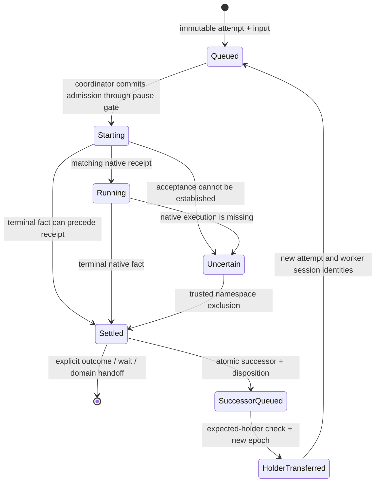

# Workspace orchestration and sleep ownership

## Executable transition contract (2026-11-03 revision)

The coordinator is the authority for task transitions and execution admissions. The Orchestrator
chooses work and reviews results. Workers report progress, waits, and outcomes. Their tools
submit durable commands; they do not apply task lifecycle transitions in their native process.

| Facet / transition | Authority | Next action owner | Durable boundary |
|---|---|---|---|
| User input → accepted input | HTTP intake | Coordinator instance | SQLite receipt + queued event |
| Task proposal / assignment / review / wait / completion | Coordinator | Requesting Orchestrator or worker, then coordinator instance | Command intent; effect and result commit together |
| Queued attempt → admitted | Coordinator | Native execution instance | Admission, immutable key, auth scope, runtime ID and replay deadline before transport |
| Admitted → native receipt | Coordinator | Native execution instance | Matching receipt; terminal status cannot change |
| Running → settled / uncertain | Coordinator | Coordinator or exact runtime supervisor | Outcome or retained execution obligation |
| Settled → retry | Coordinator | New worker session, after holder transfer | Predecessor disposition + successor + current pointer in one workspace transaction |
| Task ownership → successor | Coordinator | New worker session | Expected previous holder, new lease epoch; admission waits for transfer |
| Settled delivery → rerouted guidance | Coordinator | Current assigned execution | Stable successor intent; originating event need not fire again |
| Release requested → unclaimed | Coordinator | Planner / Orchestrator | Stop/exclusion evidence; remove reservation after domain release |
| Pause / resume | Workspace setting is the single admission gate | Coordinator drains / resumes | Persist pause before admission checks |
| Missed notification / crashed owner | Same coordinator transition functions | Replacement coordinator instance | Durable rows and event cursors; reconciliation supplies facts |
| Unknown execution → excluded | Existing runtime supervisor | Exact replacement runtime | Private namespace replacement, never an age-based lease takeover |

A terminal attempt never returns to another status. A delayed receipt may attach matching
evidence, but cannot revive it. A retry or post-stop worker resume receives a deterministic new
session and attempt identity. The handoff carries the durable task record, worktree and branch,
previous outcome, pending inputs, and bounded recent transcript. Live steering keeps its current
execution identity. If the target ends first, advancement consumes a durable reroute obligation.

`task_assignments.current_attempt_id` identifies the authoritative execution. Release examines
that pointer and every outstanding execution obligation for the task, rather than the latest
message. Old worker sessions retain their old lease epochs. New task transition requests from a
superseded or terminal execution are refused. Reports already accepted for the current attempt
retain their authority after worker exit until the coordinator records their disposition.

Commands require caller-stable `operation_id` values. Repeating an ID returns its durable result;
a changed payload is refused. Native tool schemas require the ID for every command action.
`task.command` reads a pending result. Human store commands can supply the same ID in their
arguments. A new ID is a new intent, not a retry. Command application has a 120-second deadline
and three application attempts. Exhaustion produces an explicit failed result. A release that
cannot establish native termination within 60 seconds requests private-runtime exclusion.
Committed terminal evidence permits release even after the native receipt was retired.

Domain commands commit their effects and acknowledgment in one Coworld transaction.
Assignment and release effects live in the workspace store; their command-keyed effect receipts
commit with those effects. Recovery reads those receipts even after the reservation disappeared
or the application budget expired. Claim registration is idempotent and preserves its recorded
worker profile. All paths acquire the admission lock before the Coworld writer.

Only unplanned worker endings spend `recovery.max_attempts`. This includes a completed native
run that left an actionable task unfinished. Successful waits and planned pause/resume cycles
do not spend that budget. Exhaustion records an ordinary failed task and stops retrying.
Definitively rejected task guidance has a separate delivery count under the same configured
limit. It receives immutable successor identities, including guidance without source-message
IDs. Exhaustion records a visible failed-delivery disposition and retains its message reservations;
uncertain delivery is never retried. A nonfailure reroute does not spend a failure attempt.

Inference exhaustion is an intentional wait. It retains the queued identity without freezing a
native admission or spending recovery attempts. The runtime lease owner resolves a spent-key
wait by installing a different key; provider backoff can also resolve by its declared deadline.

Within one process, committed events wake dispatch, workflow advancement, and the relay event
stream through a condition notification. The event row is durable; notification loss cannot lose
work. Cross-process command intake and native observations retain bounded polling. Native
stream-hook plumbing is not required for correctness. The periodic reconciler uses the same
outcome transition and has no separate retry or assignment policy.

`/status` and `research watcher status` expose coordinator instance identity, execution owners,
waiting reasons and resolving triggers, predecessor dispositions, successor IDs, and pending
commands with their owner, deadline, and attempt count.

Verification consists of an independent executable model and SQLite refinement tests:

- One task with two attempts: 19,404 reachable states and 136,662 explored edges.
- Two concurrent tasks with one attempt each: 213,444 states and 1,763,916 edges.
- Every explored state satisfies execution exclusion, absorbing terminal outcomes, the pause
  gate, finite attempt budgets, and durable handoffs. Every state has a recovery route to an
  explicit disposition. Event delivery can be duplicated, delayed, or lost before replay.
- Implementation cuts cover before/after commit, before notification, native acceptance before
  receipt, successor transfer, cross-store effect before acknowledgment, and delayed old writes.
- The packaged probe invokes the pinned interpreter's plugin callback against the running
  image coordinator. It checks stable replay, changed-payload refusal, one task, one coordinator
  owner, and user approval while the normal pause gate is closed. No model is invoked.
- Release tests cover accepted native start before its receipt, lost replies, and coordinator
  replacement. The independent model includes release requests and verified exclusion.
- Inbox tests accept reports before worker exit and apply them afterward. Pending reports pin
  the originating attempt against retry, resume, and guidance-driven replacement. Explicit lease
  epochs survive command persistence; superseded attempts cannot apply new reports.

The packaged restart probe injects a ledger obligation rather than an actual native worker.
It proves retained bookkeeping, runtime identity replacement, and recovery signaling. It does
not prove that a native worker accepted before a lost reply was excluded by container exit.
That combined packaged fault cut remains unverified; native/component tests and process-boundary
inspection provide separate evidence, not a substitute for that missing end-to-end cut.

This is bounded verification of the task/execution contract. Progress assumes eventual storage
and service availability, observation, and supervisor recovery. It does not prove arbitrary shell
or remote effects are reversible, nor lossless native descendant-result delivery. Those retain
the explicit limitations below. The image uses the existing sleep lifecycle; no upstream change,
merge, deployment, or production activation is part of this revision.

> **Status:** Draft; runtime constraints identified, release prerequisites unproven **Author:** Codex, on behalf of Rohit **Created:** 2026-11-02

## Implementation in this PR

This PR consolidates admission and assignment while preserving deployed lifecycle v1.
Merging it triggers the hosted image release workflow. It is not a dormant platform migration.

- `research serve` owns admission, workflow transitions, and reconciliation. Cron records observation requests only.
- Chat and UI inputs are durably accepted; follow-ups steer a live run. Task starts and continuations use immutable native replay identities.
- Answers commit with their delivery obligation. Assignment commits its session, context, rationale, revision, and capacity reservation together.
- Reconciliation and coordinator workflow run separately from chat admission. A failed observation is logged and retried without shutting down HTTP.
- An unknown run or an unreplayable start closes with a visible error and is not resent. Execution uncertainty stays in sleep/capacity accounting. The image supervisor automatically recycles the runtime; a fresh image boot ID clears the obligation after the old container exits. This provides an automatic exit rather than an operator-only wedge.
- A release request stops the recorded worker, then returns its Task to scheduling and removes the reservation. Exhausted recovery records a failed Task for normal model review.
- Explicit Stop and idle sleep retain pause/drain/settle/flush behavior. Unsettled recorded runs or failed flushes prevent readiness; there is no unconditional sleep prohibition.

The specification below describes the stronger future lifecycle v2, descendant containment,
lossless delivery and platform wake-ordering work. Those are not prerequisites retroactively
imposed on lifecycle v1, and this PR does not claim to provide them.
The previous draft's blanket sleep refusal and operator-only resolution states were removed in review.

## Coordinator ownership revision

`Coordinator` owns assignment admission, attempt outcomes, continuation, retry budgets,
release, and model handoffs. `task.assign` and `task.release` persist durable commands and may
return pending receipts. Coordinator application uses the same admission lock. Workers report
task results and messages through the inbox;
they cannot dispatch replacement attempts.

There are three service activities:

1. The admission dispatcher delivers durable inputs. Its native status polling calls
   `Coordinator.settle_attempt`; start-time observations use that same outcome transition.
2. The coordinator workflow consumes durable outcomes and explicit domain events. It queues
   continuations and model handoffs, and invokes wait, merge, goal, capability, and policy
   operations. These operations have no independent scheduler or generic function-hook bus.
3. The reconciliation loop periodically recovers missed native outcomes. It calls the same
   settlement transition and never selects workers, creates retries, or advances domain work.

`client_admissions.op_id` is the attempt identity; the Coworld Task and its Session remain
separate identities. A terminal attempt never returns to queued. Its successor uses
`retry:<predecessor-op-id>`. `advanced_at` acknowledges the completed durable handoff.
Recovery checks an existing successor before counting the retry budget. A crash between
successor creation and acknowledgment therefore cannot create another successor or fail it.
Inactive Coworld outcomes remain pending until their recorded domain is selected.

Wake claims retain their event and session identity across interrupted registration or
queueing. Native completion acknowledges every event assigned to that wake. Failed wakes
receive a new attempt under the coordinator's bounded policy. Stops for sleep do not consume
the failure budget. Continuations use event identities, stopped-run identities, or source-message IDs.
Already reserved messages cannot be copied into a later continuation. All use the ordinary dispatcher;
there is no independent raw-steer or resume implementation.

Missing or unreachable native runs do not prove termination. Unknown receipts retain an
execution obligation until the managed runtime's private process namespace is replaced, or
an unmanaged local owner acknowledges stopped execution. Release waits for a terminal receipt
or that exclusion evidence. Legacy holders without receipts use the same obligation instead
of silently releasing ownership. No lease-age takeover is permitted.

Pause uses the same final admission gate for chat, assignments, retries, and model wakes.
Settling outcomes and recording handoffs remains safe during pause; execution waits for resume.
The former twelve-step dynamic watcher, independent recovery/message loops, native wake
completion polling, and dynamic function-handler resolution are deleted. Remaining files in
`watcher/` provide domain operations, read models, rendering, and the lifecycle-v1 drain API.

### Verification for this revision

The consolidated tests exercise the production admission dispatcher. They cover normal versus
reconciled completion producing one review handoff, crash replay after successor enqueue,
terminal attempt identity, retry exhaustion, pause before admission, uncertain release,
source-message steering, interrupted wake registration, wake retries/coalescing, inactive
Coworld handoffs, and workspace-only wakes. Existing tool, domain, sleep, and scenario suites
remain in the full test run. Tests of the deleted autonomous scheduler APIs are replaced by
these coordinator flow tests.

The earlier packaged image passed four normal sleep/restart cycles and one injected-obligation
runtime replacement. This revision requires a fresh pinned-runtime and packaged-image check;
those earlier results alone do not validate the new ownership flow. No merge or production
activation is authorized. Native descendant containment and lossless background result delivery
remain separate limitations; this change does not claim to solve them.

## Summary

One workspace coordinator owns assignment admission, recovery, and the evidence authorizing sleep.
The Orchestrator model chooses workers, context, and dependencies.
Deterministic code commits those choices before starting work.
Kubernetes owns compute and orders wake against scale-down through conditional Deployment updates.

This revision resolves the original open questions against source from the pinned Hermes runtime.
The runtime supports durable top-level deduplication, with a finite replay horizon.
Its plugin and process APIs do not establish the full descendant and lossless-delivery guarantees this design requires.
Those are explicit release gates, not assumed capabilities or invitations to modify upstream.

## Problem and current path

| Input | Current execution owner | Current durable records |
| --- | --- | --- |
| Chat | `serve.dispatch_messages` | Workspace `client_admissions` |
| Research task or resume | `Coordinator` | Immutable workspace admissions and task assignments |
| Model event wake | `Coordinator` | Event claims, sessions, immutable workspace admissions |
| UI answer | `serve._answer`, `serve._deliver` | Answer committed before direct native delivery |

Researcher selection is round-robin.
A worker generally claims task ownership in its first tool call, after execution starts.
Sleep separately scans sessions, selected processes, and pending intents.
That scan does not cover all native descendants or undelivered results.

The inherited admission-lock prototype is preserved separately.
It closes two researcher races, but does not implement this design.
The inherited decimal-revision conversion must not ship: deployed intent IDs are opaque UUIDs.

## Runtime findings and decisions

Evidence distinguishes verified source behavior, diagnostic tests, and required implementation.
No live deployment was changed or verified during this revision.

| Question | Actual runtime evidence | Decision |
| --- | --- | --- |
| Does native start deduplicate durably? | `RunIdempotencyStore.reserve` uses `BEGIN IMMEDIATE` and a unique `(scope,key)` row before launch. Matching replay returns the original run; changed payload conflicts. | Reuse this contract; require advertised durable storage before enabling dispatch. |
| Is replay permanent? | Terminal reservations can be pruned after 86,400 seconds. Nonterminal reservations survive that pruning. | Never blindly replay an unresolved start after its safe retry deadline. |
| What defines the native scope? | `_run_idempotency_scope` includes profile and bearer-key identity for ordinary API callers. | Persist profile and authentication generation; rotating a key invalidates blind replay. |
| Does restart resume the same process? | `_durable_run_status` marks a dead owner's nonterminal run interrupted. | One admitted attempt can end interrupted. Continuing work requires a separately recorded continuation. |
| Can a plugin guarantee all child admission? | `pre_tool_call` supports vetoes; `subagent_start` is an observer. Callback failures generally block, but `_pre_tool_block` catches dispatcher failures and permits execution. | Hooks improve normal pause behavior but cannot be the sole safety boundary. |
| Are undelivered native results permanent? | Delegation pruning retains only 50 terminal rows; replay can drop results after 48 hours or eight delivery attempts. | Native delivery alone cannot satisfy lossless workspace result retention. |
| Does process tracking cover arbitrary shells? | `process_registry` checkpoints registered background processes. Checkpoint errors are logged; detached shell descendants can outlive registered parents. | A registry snapshot cannot authorize sleep alone. |
| Is the native retirement fence suitable? | `RetirementFence` belongs to Desktop backend retirement; commit closes that process permanently. Hosted startup runs `hermes gateway run`. | Do not treat the Desktop endpoint as a hosted reversible pause API. |
| Can two pods mount the workspace? | The platform requests `ReadWriteOncePod`, `replicas=1`, and deployment strategy `Recreate`. | Build on single-pod storage exclusion; verify the actual claim and driver before activation. |
| Does platform scale-down have a conditional boundary? | `reconcile_image` patches replicas and annotations with Deployment `resourceVersion`; wake patches the same resource conditionally. | Use that update as the stop commit, and fix the current wake fast path described below. |

Native source identity: image index `nousresearch/hermes-agent@sha256:9774f4f39a9bb8c2f68ce728ed5e99ddbad282163be56764afacf88ed952b784`.
Its AMD64 manifest is `sha256:ffa4fbb471c2bc8c85fbcfc629347585cc1586c86d2e6db465d01203ce696d95`.
Source-layer digest `sha256:49a9da722157de36fc218242b18b8dde0a9bb619ba7e68a929ec8e7d69e84fb2` matches the audited archive.
These findings describe that source layer; final assembled-image acceptance remains required.
Distribution PR #144 merged as `74c853d`; this implementation is based on that commit.
Its native pin is `sha256:d27689bc6e8581ec884a7227c9101fdaebf6c853cff8859020dac14f21452b4d`.
The earlier source audit above is historical evidence. Revalidate unresolved contracts against
the assembled image before activation; the changed pin alone does not qualify them.

Source references: native `gateway/platforms/api_server_runs.py`, `api_server_run_idempotency.py`, `agent/tool_executor.py`, `hermes_cli/plugins_dispatch.py`, `backend_retirement.py`, and `tools/async_delegation.py`, `process_registry_checkpoint.py`.
Platform references: `clients/hermes/kubernetes.py:reconcile_image`, `wake`, `request_state`, and `clients/workspace_pod.py:pod_spec`.
Distribution references are relative to the nested `distributions` checkout.

## Goals and scope

The full release requires all these properties:

- Durable acceptance and replayable receipts for inputs, assignments, answers, and delivery obligations.
- One coordinator owns every top-level queued-to-admitted transition.
- Explicit model-selected assignments and pre-start task reservation.
- Recovery preserves the same native attempt within the verified native replay contract.
- PAUSING closes new admission while retaining uncertain and already-admitted work.
- READY follows settled execution, preserved delivery obligations, and flushed state for the current intent and runtime incarnation.
- Parallel workers, nested delegation, arbitrary valid tools, and Coworld choice remain available.

Exactly-once arbitrary tool effects, transparent process checkpointing, and bounded sleep latency are not promised.
Unresolved remote writes or uncheckpointable processes can require an explicit recovery decision.
The platform does not own research tasks, internal agent state, or coach/league restrictions.
No upstream integration, private runtime fork, or live-container patch is authorized.

## Ownership and durable records

Extend the existing workspace admission ledger rather than create another input queue.
Keep Coworld stores as domain records; the workspace ledger is the execution inventory across all Coworlds.
Store immutable input identity, payload/hash, assignment ID, parent ID, task/version, profile, session, native key, authentication generation, attempt, timestamps, and outcome.
Completion delivery uses an outbox in that same workspace database.
Each result has a stable result ID; each fan-out destination has a separate stable delivery ID and pending/acknowledged state.
For workspace-owned destinations, a unique destination inbox key deduplicates insertion, and acknowledgment commits with that insertion.
For external destinations, delivery is at least once unless that destination supplies durable deduplication for the delivery ID.
A lost acknowledgment permits replay; it never marks delivery complete by inference.
Retain the payload and acknowledgment/tombstone until every destination is acknowledged or an explicit durable disposition closes it.
This guarantees retained results and deduplicated inbox insertion, not exactly-once model processing or downstream tool effects.
Persist an answer and its outbox obligation in one transaction before acknowledging it.
A retry with the same operation ID and payload returns the existing receipt; changed payload returns a typed conflict.

Only `research serve` coordinates assignments and top-level starts.
HTTP, relay, watcher, and sleep/wake CLI paths submit inputs or observations to that owner.
Remove their direct starts, autonomous round-robin dispatch, and separate sleep authority.
The image supervisor remains an actuator for process control, not an assignment authority.

The coordinator holds an exclusive workspace-file lock for its lifetime, before opening execution admission.
That lock prevents multiple coordinators within one mounted runtime.
Cross-pod exclusion comes from the single-pod volume and replacement policy, not from a claim about distributed `flock`.
Reject startup if effective storage or deployment configuration permits concurrent writers.
Do not force-delete an unreachable pod and attach its disk elsewhere as a recovery shortcut.
Unexpected pod loss preserves unresolved outcomes; it does not count as clean sleep.

## Execution and task reservation

| State | Transition and required evidence |
| --- | --- |
| QUEUED | Input is durable; execution has not been authorized. |
| RESERVED | Assignment and capacity slot are committed; task reservation is being completed. |
| ADMITTED | Lifecycle was RUNNING in the transaction committing fixed payload, profile, session, and native key. |
| START_UNCERTAIN | A native request may have reached Hermes; retain the same key and capacity reservation. |
| RUNNING | Native receipt is committed. |
| TERMINAL | Persist native outcome and result/delivery obligation together. |
| SUSPENDED | A continuation record and owned-resource inventory are durable; original execution has stopped. |
| NEEDS_RESOLUTION | Safe automated reconciliation is exhausted; keep ownership and expose a typed reason. |

No network request occurs inside a workspace database transaction.
`ADMITTED` is permission to launch that fixed attempt; a request reaching Hermes after PAUSING can still belong to this admitted set.
PAUSING cannot erase it because no run ID was received.
A native 404 is uncertainty, not evidence of completion or permission to start again.
Do not adopt the current client's terminal interpretation of `unknown` for coordinator recovery.
Payload conflicts, missing durable capability, and authentication-generation changes produce typed failures, not new keys.

Set `safe_retry_until` from the first possible send, using the advertised retention minus a configured safety margin.
A coordinator restart never extends that deadline without native evidence.
Before the deadline, retry with the same profile, authentication generation, session, key, and byte-equivalent request body.
Afterward, query a known run ID or reconcile native durable state; do not POST merely to discover whether the old key exists.
The workspace permanently retains its own terminal receipts even after Hermes expires its replay records.

Task reservation spans two stores, so record a recoverable sequence:
commit assignment and session in the workspace; claim that task for the recorded session; commit reservation completion; then admit native execution.
Recovery repeats this sequence for the same assignment.
The authoritative ownership record is a unique workspace reservation for `(coworld_id, task_id)`; the Coworld lease mirrors it.
Every supported claim, release, takeover, and worker admission path acquires the same workspace ownership-transition lock before inspecting either store.
Under that lock, write workspace reservation first, then Coworld claim, then workspace reservation completion; no network call is allowed there.
Release records STOPPED evidence, releases the Coworld mirror, and only then frees the workspace reservation under that same lock.
A crash leaves the workspace reservation held; the next owner finishes or reconciles that transition before permitting a new claimant.
The coordinator's lifetime lock and this short transition lock serve different purposes.
Update all library, CLI, and tool call sites; no direct Coworld-only claim path remains supported.
If the workspace ledger or transition lock is unavailable, fail closed with a typed refusal.
A failed task/version/dependency check releases the capacity reservation with an explicit rejection.

The existing task lease becomes stale after 300 seconds.
Lease age will indicate health, not authorize reassignment.
Change every task-claim and recovery path to refuse takeover while the workspace assignment is reserved, uncertain, running, suspended, or awaiting resolution.
The coordinator renews live reservations independently of worker tool calls.
Reassignment requires the old execution subtree stopped and its ownership explicitly released.
Task epoch checks fence store writes; they do not fence arbitrary shell or external side effects.
A continuation gets a new attempt/key only after that release decision is durable.

## Planning and routing

Planning is an admitted Orchestrator execution in the same ledger, not an untracked external caller.
The coordinator creates one planning input per batch of unassigned task versions.
Repeated observations coalesce into that input while it is queued or running.
Planning recovery obeys the same native replay rules.

A typed assignment tool submits an assignment ID, planning ID, task/version, profile, context, rationale, and dependencies.
The coordinator checks task revision, profile availability, dependency completion/cycles, current ownership, and capacity.
Assignment identity is unique and replayable; validation failures return typed feedback to the planner.
Capacity is reserved atomically with assignment acceptance, before any worker starts.
Planning has an explicit separate capacity allowance so full worker slots cannot prevent recovery planning.

Worker choice uses configured capability descriptions and current assignments, with no round-robin fallback.
Routing evaluation includes specialist selection, unavailable workers, dependency chains, saturated capacity, and repeated planning after a crash.
Acceptance requires zero ownership/dependency violations and a recorded rubric score for suitable worker choice.
Model preference remains revisable; deterministic ownership does not depend on its judgment being correct.

## Pause, continuation, delivery, and readiness

| Workspace state | Allowed actions |
| --- | --- |
| RUNNING | Persist intake; admit planned executions and normal tool work. |
| PAUSING | Persist intake, reconcile existing admissions, record checkpoints/results, and perform bookkeeping delivery. No fresh execution admission. |
| READY | Execution remains closed. Only observation and durable intake are allowed until an explicit newer wake invalidates readiness. |

A tool admitted before PAUSING may finish creating its already-authorized child batch.
A later delegation or background-process tool call is fresh admission and is refused.
That refusal requests suspension; it must not strand the parent without a recorded outcome.
A parent that needs another child, human answer, or model delivery run records a continuation and stops.
A model completion-delivery turn is execution and waits for wake; copying a result into the outbox is bookkeeping and can proceed during PAUSING.

SUSPENDED means the record contains the continuation identity, session/history location, pending input, task ownership, resource handles, and explicit restart procedure.
It also requires proof the original execution cannot keep running.
An interrupted arbitrary command is NEEDS_RESOLUTION unless its operation ID and supported status/idempotency API establish a safe continuation.
Neither SIGTERM nor a saved transcript alone proves resumability.

Queued inputs and parked outbox rows do not block READY if their entire payload and continuation are durable and no live execution depends on immediate delivery.
An answer and its delivery obligation are accepted atomically.
A parent restart does not create a new delivery identity. Lost acknowledgments may still require replay under the destination contract.
A new input invalidates READY in the same local acceptance transaction, before acknowledgment.
If platform scale-down wins the race, the input must already be retained and scheduled for wake; acknowledgment cannot rely on a connected socket remaining open.
At hosted ingress, check explicit platform pause/maintenance state atomically with conditional wake registration under the existing owner serialization and Deployment resourceVersion precondition.
A separate preliminary pause check is insufficient; a conflict requires re-reading current pause/intent state before retry.
Ordinary input to an explicitly paused workspace returns `workspace_paused` before wake registration or forwarding; only explicit resume changes that intent.
For an automatically sleeping or running workspace, persist an idempotent platform wake operation keyed by input ID before forwarding input to a runtime.
The platform owns retrying that operation independently of client and workspace liveness.
Its conditional wake update invalidates earlier stop evidence or schedules replacement compute if scale-down already committed.
Keep the payload in the workspace ledger; the platform record contains wake/control metadata, not another research-task queue.
The wake operation remains outstanding until durable input confirmation, explicit cancellation, or the five-minute `delivery_unconfirmed` expiry described below.
While outstanding, platform reconciliation keeps compute requested and rejects automatic scale-down for that operation's workspace.
The input-acceptance transaction also invalidates local READY, so an acknowledgment cannot race an unchanged local readiness claim.
If wake or delivery confirmation is uncertain, return `input_acceptance_unconfirmed` with the same operation ID; this is not an acceptance acknowledgment.
The platform retries the control operation, but cannot retry a lost payload it does not retain.
The client must retry the same payload and ID to obtain a workspace acceptance receipt.
After five minutes without confirmed workspace acceptance, record `delivery_unconfirmed` and release the input-specific keep-awake reservation.
Explicit cancellation can release it earlier. Neither outcome asserts that forwarding failed or revokes work that the workspace may already have accepted.
A later retry first reconciles the existing workspace receipt; it does not mint a new input or execution identity.
If the client disappears before acceptance is confirmed, eventual delivery is not guaranteed; retaining the payload at ingress would be a separate delivery-buffer feature.
If ingress cannot durably register the wake operation, do not forward or acknowledge acceptance; return a retryable error.
Direct local HTTP use has no platform-wake guarantee and must state that limitation.
A local in-runtime user pause can still accept queued inputs without reopening execution; it does not override platform pause/maintenance.

## Descendants: resolved boundary and release gate

The current runtime has no supported atomic workspace-wide descendant admission/delivery contract.
`pre_tool_call` is useful for normal cooperative pause enforcement, but its dispatcher can fail open.
`subagent_start` cannot veto or prove a durable reservation.
Native child records can be pruned or dropped before successful delivery.
Native process checkpoints are best-effort records of registered processes, not containment of arbitrary commands.
These are negative answers to the original hook and detached-process questions.

Do not implement READY by summing those observer/registry counts.
The full release requires an image-owned execution supervisor around the native gateway and its process descendants.
Its process lifecycle is subordinate to coordinator commands.
After cooperative suspension, it must stop further native execution and establish that its entire owned subtree has exited before the coordinator flushes storage.
A dedicated Linux subreaper can retain ownership of double-forked and `setsid` descendants; group signals alone cannot.
This is an implementation candidate, not a capability the current image already has.
No cgroup administration or extra container privilege is assumed.
The target gVisor runtime must prove adoption, PID-incarnation-safe termination, draining of concurrent forks, and zero surviving descendants.
If it cannot, planned sleep remains unavailable with a specific process-boundary reason; do not weaken READY.

Local process containment excludes remote work, including BuildKit and external tool operations.
Classify operations explicitly rather than require the coordinator to infer arbitrary shell behavior:

- Supported resumable classes have typed adapters that record operation ID and resource handle before dispatch, with documented status, stop, and deduplication contracts.
- Arbitrary tools and shell commands remain available, but do not acquire an invented resumability guarantee.
- Unclassified work must finish uninterrupted before clean sleep, or receive an explicit uncertain/interrupted disposition requiring resolution before continuation.

A lost remote handle produces NEEDS_RESOLUTION; killing the caller does not establish remote completion.
Automatic sleep waits while unclassified work is active and does not force-kill it to meet a latency target.

Lossless native child results are a separate unsatisfied prerequisite.
Copying retained rows at sleep time cannot recover results pruned earlier during RUNNING.
An observer-only hook cannot guarantee that copy.
Before claiming the full release, identify and test a supported durable capture/acknowledgment path we control, including nested children and result fan-out.
If none exists, report this exact capability gap to Rohit; do not depend on an upstream change or label the full design complete.
Top-level admission consolidation can proceed independently, but cannot advertise complete descendant readiness or lossless child delivery.

## Intent identity and wake/stop ordering

Retain opaque UUID intent IDs. Never parse existing IDs as decimal numbers.
For command ordering, add a separate workspace-local monotonic sequence initialized during the matched upgrade.
A conditional Deployment update increments sequence and changes intent ID together.
This additional ordering is required because runtime control messages can arrive after newer commands; UUID equality alone cannot reject a previously unseen stale command.
The sequence is not a global scanner epoch and does not order research tasks.

The runtime persists the highest accepted sequence, ID, desired state, and runtime incarnation before applying effects.
A lower sequence is rejected; the same sequence/ID is an idempotent retry; the same sequence with a different ID conflicts.
Only the coordinator applies lifecycle effects, serially.
Observation is read-only and cannot implicitly wake or sleep the workspace.
Automatic idle sleep first obtains a platform lifecycle intent; an image-local timer cannot independently publish permission to terminate.
A newer wake invalidates old READY immediately, finishes or cancels the current owned shutdown safely, and restarts execution services before reopening admission.

The stop commit is the existing conditional Deployment update that writes `replicas=0` and the stopping/sleeping marker together.
It uses the resourceVersion from the snapshot that produced the readiness request.
Readiness must match the intent ID, sequence, pod UID, and container incarnation.
A changed Deployment makes that update conflict; the scanner fetches current state and requests fresh evidence.
There is no subsequent unconditional direct pod delete.

Fix the current wake fast path: a wake accepted while desired state is already running must still invalidate an in-flight sleep decision.
Coalesced wake requests use a durable operation identity; the first performs a conditional intent update even before SLEEPING/DRAINING markers appear.
Retries return its existing receipt; they do not rotate revisions repeatedly.
If wake commits first, stale scale-down conflicts.
If scale-down commits first, wake changes the intent and restores desired replicas after the old pod settles; preserving that exact pod is not promised.
User-requested pause still requires explicit resume; an ordinary message cannot override it.

### Execution-service generations

Persist service generation and phase separately from RUNNING/PAUSING/READY:
STARTING, ACTIVE, QUIESCING, STOPPED, or FAILED.
Every actuator command carries a command ID, target service generation, and process incarnation.
The image supervisor executes commands serially and returns durable/idempotent receipts.
It cannot apply a stop for generation N to processes belonging to generation N+1.

On wake during QUIESCING, record the newer desired intent and invalidate readiness, but keep admission closed.
Complete stop of generation N; then start N+1 and confirm capability checks, required plugin registration, and service health before committing ACTIVE and reopening admission.
Do not cancel a shutdown and assume the old process will survive.
On supervisor restart, reconcile the recorded generation against actual processes before running further actuator commands.
Uncertain process identity yields FAILED/NEEDS_RESOLUTION rather than admitting work.
This adds an execution-service phase, not another task or lifecycle decision owner.

### Storage durability at READY

READY means durable state on the retained volume, not completion of an external snapshot.
After execution writers stop, checkpoint/fsync native and workspace state and record the execution/delivery disposition.
Subsequent allowed intake commits use the workspace SQLite `synchronous=FULL` contract; the retained volume includes its WAL and database files.
Such intake invalidates READY transactionally and requires a fresh readiness check before another stop decision.
No unflushed document, worktree, result-file, or external-resource mutation is permitted behind an unchanged READY response.
A backup or migration snapshot needs its own intake barrier and coherent database/WAL handling; the earlier readiness flush is not that barrier.

## Recovery liveness and operator outcomes

Retry transient reconciliation with bounded exponential backoff, while keeping ownership reserved.
After the safe retry deadline or an unresolvable status/authentication/process error, expose NEEDS_RESOLUTION with assignment, native key/run ID, last evidence, and reason.
Do not spin indefinitely or free the task because a timer elapsed.
Other independent work may continue while RUNNING; clean sleep remains unavailable if live or uncertain effects remain.

Supported resolution actions are: attach verified outcome evidence; stop the owned local subtree and record interruption; or authorize a new continuation after resolving external effects.
The owner chooses an action through a typed coordinator command; every decision is durable and idempotent.
No command may invent success or convert an unknown external write into a safe retry.
Zero repeated manual approvals applies to ordinary development; exceptional uncertain effects are not silently repeated.

## Matched upgrade and activation

The selected wire is strict lifecycle v2: opaque intent ID, sequence, desired state, and runtime incarnation.
Keep v1 parsing strict; select protocol through qualified runtime metadata, not an error-triggered fallback.
Implement this gate before exposing v2 runtime qualifications.
The existing request UUID remains request identity, separate from intent identity.

Protocol routing belongs to the platform relay, using the persisted qualified runtime record owned by `WorkspaceClient` and its qualification lookup.
Qualification binds a distribution/image digest and supported lifecycle protocol; it is release evidence, not evidence of a particular live connection.
A v2 runtime must register on a v2-only control connection with protocol, boot ID, and pod identity.
The platform validates the current pod's resolved image against qualification and binds the connection to pod UID, container ID, and boot ID.
Use a fresh challenge/response and verify the same container incarnation before and after it; a buffered hello alone cannot establish live ownership.
Reject ambiguous/replaced incarnations; absence of a qualified live v2 connection is unavailable, never permission to send v2 to v1.
Every in-flight control request stays bound to that connection/incarnation, even after replacement.
An old connection cannot satisfy readiness for its successor; application-operation retries recover through their durable IDs.
This registration and qualification selection are required platform/image changes, not existing runtime capabilities.

Upgrade sequence:

1. Install the platform's explicit v2 contract and qualification selection, while all existing runtimes remain v1.
2. Acquire the existing per-workspace maintenance hold and drain existing runtime work using its v1 path. Disable automatic image adoption for that held workspace.
3. Stop cleanly and verify no old pod remains. Do not force termination of unresolved work to manufacture a migration result.
4. Under conditional Deployment update, preserve the opaque intent ID, initialize its sequence, and select the qualified v2 image/protocol together.
5. Release the hold, start the new pod, run idempotent store migration, and verify its effective coordinator, disabled watcher dispatch, native durability, storage exclusion, and lifecycle contract.
6. Exercise the real path, including pending input, child completion, sleep, wake, and retained task recovery. Only then enable automatic sleep for that qualification.

The maintenance gate must be rechecked on image adoption and intent mutation, including scanners already in flight.
A stale conditional update conflicts; a cancelled RPC is not proof its admitted native effects stopped.
Rollback is a held restore of a compatible image and store snapshot, not launching v1 against a v2-migrated store.

## Verification and remaining work

Implementation evidence (2026-11-02):

- Full component suite before integrating #142: 1,593 passed, 4 environment skips, 8 installed-Hermes tests deselected.
- After integrating #142: 1,597 component tests passed, 4 environment skips, 10 installed-Hermes tests deselected.
  The affected skill/dispatch checks also passed (125 tests). Packaged native results belong in the PR checks.
- `uv run --frozen ruff check .`, `tools/build_prompts.py --check`, and `tools/export_contract.py --check` passed.
- `tools/eval_assignments.py` used the shipped Kimi model, exported tool schema, real assignment handler, and SQLite stores.
  Specialist selection scored 3/3, versus 0/3 for round-robin starting at profile zero; all three assignments persisted correctly.
  These three diagnostic cases do not establish general scheduling quality or native execution.
- Browser component proof at `http://127.0.0.1:18651/`: open a session, send a message, observe accepted/admitted/started/finished events and its completed reply.
  Repeated after integrating #142 and correcting the bundled client to send its typed message format.
  This used `SeamServer` with `FakeHermesRuns`; it is not packaged native or deployed-target evidence.
- The local Docker build failed with a daemon connection EOF. The PR's supported GitHub image runner must build and run retained-state restart coverage.
  Neither that harness nor a successful restart qualifies clean sleep or child-result retention.

Inherited evidence: 72 affected checks passed in 28.35 seconds, including the two temporary researcher race reproductions.
They validate the inherited prototype only.

New diagnostic tests invoke the native source's real `RunIdempotencyStore` against SQLite.
They confirm concurrent reservation, changed-payload conflict, reopen replay, nonterminal retention, and terminal expiry after 24 hours.
These are component tests on the local interpreter, not packaged Linux or deployed-runtime proof.
Native source inspection also establishes the 300-second task lease, hook fallback, delegation retention limits, process checkpoint scope, and hosted startup path.

Artifacts: `/Users/rohit/.codex/reports/workspace-orchestration-20261102/`.
Keep native manifests, digest receipt, probe source/results, and Sol reviews there.
The source archive matches the AMD64 manifest; the locally cached Docker image is ARM64, so its layer IDs are not substituted as source provenance.

Acceptance tests must cover: lost native response; recovery after expiry or key rotation; duplicate planning; pre-start task claim; task-lease expiry while execution survives; atomic answer/outbox acceptance; both wake/scale-down orderings; stale lifecycle messages; and replacement-pod isolation.
Descendant tests must include parent completion before child delivery, more than 50 pending native completions, nested delegation, failed hook dispatch, detached double forks, concurrent forks during shutdown, and remote work surviving its caller.
Run the packaged system harness and smallest real browser flow after the matched image and effective configuration changes.

The original open questions now have documented answers, including negative runtime capability findings.
Two deliverables are distinct: top-level admission/assignment consolidation, and automatic clean sleep under a qualified execution/delivery boundary.
The first can proceed against the verified native contract.
The second remains blocked on a supported lossless child-result path, target-runtime process-boundary proof, and implementation of the specified service-generation, ingress-wake, and protocol-binding contracts.
No bounded-latency clean-sleep guarantee is made for arbitrary unclassified remote work.
This draft authorizes neither upstream integration nor production activation.
